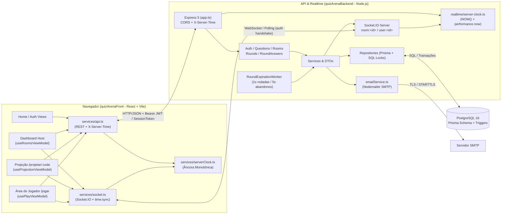
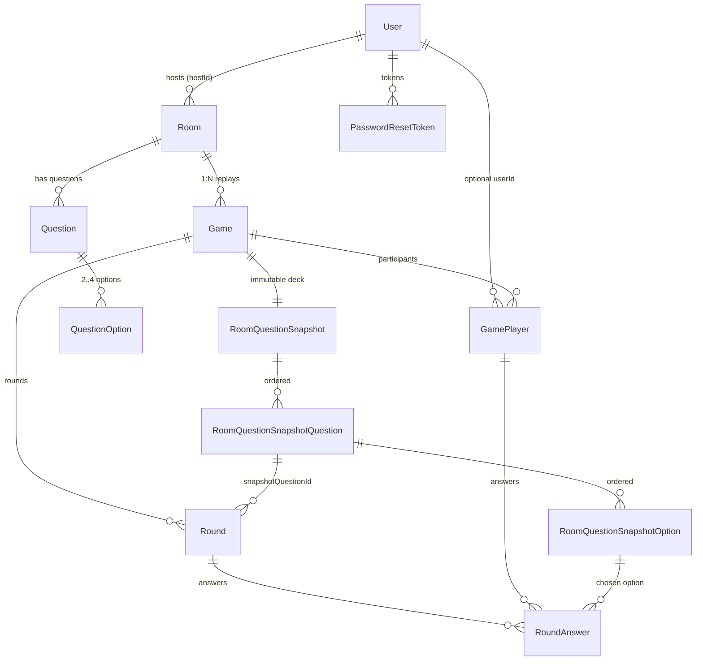
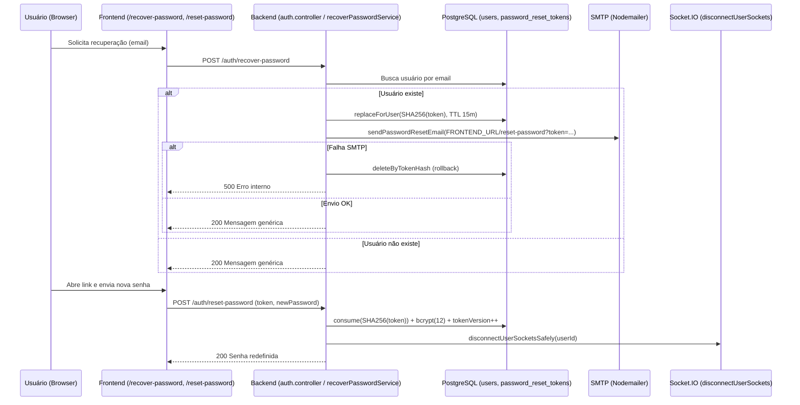
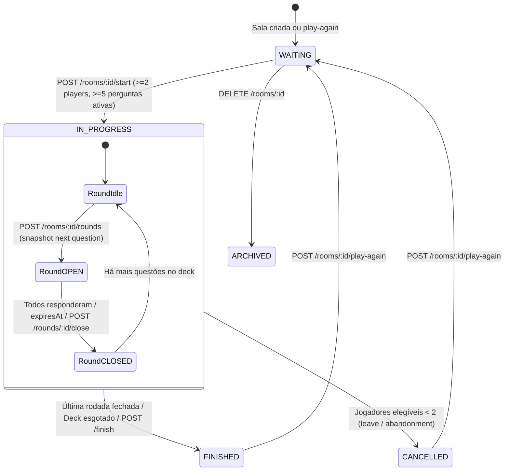
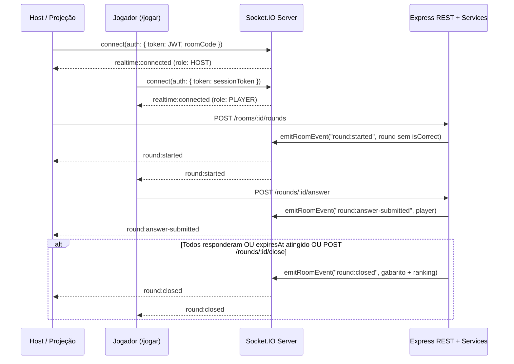

# Documentação Técnica e Auditoria de Engenharia — QuizArena (`QuizArenaGt/quizarenagt`)

> **Escopo desta documentação:** Documentação técnica atualizada diretamente a partir do código-fonte em `development` / `origin/development` (até o commit `71206c6`, com `origin/main` consolidada até o PR `#196` / `4be62d3`), incluindo schema e migrations Prisma/PostgreSQL, workflows do GitHub Actions, arquivos Docker e manifests do repositório `QuizArenaGt/quizarenagt`.

---

## Sumário

1. [Visão Geral e Objetivo do QuizArena](#1-visão-geral-e-objetivo-do-quizarena)
2. [Stack Tecnológica e Responsabilidades](#2-stack-tecnológica-e-responsabilidades)
3. [Arquitetura Geral e Comunicação Frontend–Backend](#3-arquitetura-geral-e-comunicação-frontendbackend)
4. [Estrutura de Diretórios e Organização dos Módulos](#4-estrutura-de-diretórios-e-organização-dos-módulos)
5. [Arquitetura MVVM no Frontend](#5-arquitetura-mvvm-no-frontend)
6. [Organização em Camadas no Backend](#6-organização-em-camadas-no-backend)
7. [Modelagem de Dados, Entidades e Integridade](#7-modelagem-de-dados-entidades-e-integridade)
8. [Autenticação, Autorização e Segurança](#8-autenticação-autorização-e-segurança)
9. [Gerenciamento de Salas e Participantes](#9-gerenciamento-de-salas-e-participantes)
10. [Gerenciamento de Perguntas e Alternativas](#10-gerenciamento-de-perguntas-e-alternativas)
11. [Fluxo de Partidas, Rodadas e Respostas](#11-fluxo-de-partidas-rodadas-e-respostas)
12. [Comunicação em Tempo Real com Socket.IO](#12-comunicação-em-tempo-real-com-socketio)
13. [Temporização e Sincronização de Relógios](#13-temporização-e-sincronização-de-relógios)
14. [Regras de Pontuação e Modos de Jogo](#14-regras-de-pontuação-e-modos-de-jogo)
15. [Ranking, Resultados e Relatórios](#15-ranking-resultados-e-relatórios)
16. [Projeção da Partida e Experiência do Jogador](#16-projeção-da-partida-e-experiência-do-jogador)
17. [Infraestrutura, Docker, Ambientes, CI/CD e Deploy](#17-infraestrutura-docker-ambientes-cicd-e-deploy)
18. [Qualidade, Comandos e Suíte de Testes](#18-qualidade-comandos-e-suíte-de-testes)
19. [Programação Orientada a Objetos (POO) e Princípios SOLID](#19-programação-orientada-a-objetos-poo-e-princípios-solid)
20. [Design Patterns](#20-design-patterns)
21. [Princípios Complementares de Engenharia de Software](#21-princípios-complementares-de-engenharia-de-software)
    - [Exemplos de código para demonstração na avaliação](#exemplos-de-código-para-demonstração-na-avaliação)
22. [Limitações Atuais e Itens em Aberto](#22-limitações-atuais-e-itens-em-aberto)
23. [Auditoria do Histórico GitHub e Contribuições Individuais](#23-auditoria-do-histórico-github-e-contribuições-individuais)
24. [Atendimento aos requisitos do Projeto Final – Formação Full Cycle](#24-atendimento-aos-requisitos-do-projeto-final--formação-full-cycle)

---

## 1. Visão Geral e Objetivo do QuizArena

O **QuizArena** é uma plataforma web de quizzes interativos em tempo real, estruturada em monorepo (`quizArenaFront/` e `quizArenaBackend/`). O sistema resolve o problema de conduzir dinâmicas competitivas de perguntas e respostas em sala de aula, treinamentos ou apresentações ao vivo, garantindo:

- **Controle autoritativo pelo servidor:** tempo das rodadas, cálculo de pontuação, validação de unicidade de respostas, elegibilidade de participantes e encerramento de partidas são processados exclusivamente no backend com transações PostgreSQL.
- **Separação de papéis em tempo real:**
  - **Host (anfitrião autenticado):** cria e configura salas, gerencia banco de perguntas por sala (cadastro unitário ou importação JSON em lote), inicia partidas, abre/encerra rodadas, acompanha respostas ao vivo e visualiza histórico/relatórios.
  - **Participante (`/jogar`):** ingressa de forma anônima ou autenticada informando código da sala (6 caracteres), apelido e avatar, responde às rodadas cronometradas e acompanha feedback, ranking parcial e pódio.
  - **Tela de projeção (`/projetar/:code`):** visão somente leitura dedicada para TVs ou projetores, exibindo código da sala, enunciado, alternativas, temporizador sincronizado, progresso de respostas e placar parcial/final sem expor o gabarito antes do fechamento da rodada.

---

## 2. Stack Tecnológica e Responsabilidades

| Camada | Tecnologia | Versão (manifesto) | Responsabilidade no QuizArena |
| --- | --- | --- | --- |
| **Frontend UI** | React + React DOM | `^19.2.8` | Renderização declarativa de Views, modais e fluxos interativos |
| **Roteamento** | React Router DOM | `^7.18.5` | Rotas `/`, `/login`, `/register`, `/recover-password`, `/reset-password`, `/dashboard`, `/projetar/:code`, `/jogar` |
| **Bundler / Dev** | Vite + `@vitejs/plugin-react` | `^8.3.4` / `^6.1.1` | Servidor de desenvolvimento e build de produção (`tsc -b && vite build`) |
| **Linguagem Front** | TypeScript | `~6.0.2` | Tipagem estática de Models, Services, ViewModels e Views |
| **Realtime Front** | `socket.io-client` | `^4.8.4` | Cliente WebSocket/polling para eventos da sala e `time:sync` |
| **Runtime Backend** | Node.js | `24` (CI/local) / `22-alpine` (Docker) | Execução da API HTTP, servidor Socket.IO e worker em background |
| **Framework HTTP** | Express | `^5.2.1` | Roteamento REST, `trust proxy`, CORS, rate-limit, parsing JSON e error handler |
| **Linguagem Back** | TypeScript + `tsx` | `^7.0.2` / `^4.23.15` | Tipagem estrita (`strict`, `noUncheckedIndexedAccess`, `exactOptionalPropertyTypes`) e watch em dev |
| **ORM / Banco** | Prisma + PostgreSQL | `^6.19.3` / `postgres:16-alpine` | Modelagem relacional, migrations SQL com triggers/índices parciais, `createManyAndReturn` e `SELECT ... FOR UPDATE` |
| **Realtime Back** | Socket.IO | `^4.8.4` | Salas lógicas (`room:<roomId>`, `user:<userId>`), handshake dual (JWT / `sessionTokenHash`) e broadcast de eventos |
| **Segurança Auth** | `jsonwebtoken` + `bcryptjs` | `^9.0.3` / `^3.0.3` | Assinatura/verificação JWT (`HS256`) e hash de senhas (custo `12`, limite 72 bytes UTF-8) |
| **E-mail Transacional** | `nodemailer` | `^10.5.0` | Envio de links de recuperação de senha via SMTP (TLS/STARTTLS) |
| **Testes Back** | Vitest + Supertest + `dotenv-cli` | `^5.1.0` / `^7.3.1` / `^11.1.0` | Testes unitários, cobertura (`@vitest/coverage-v8`) e testes de integração HTTP/Socket/PostgreSQL |
| **Testes Front** | `node:test` nativo | Node 24 built-in | Execução da suíte TypeScript em `quizArenaFront/tests/*.test.ts` (type-stripping nativo) |
| **Linting** | ESLint + `typescript-eslint` | `^10.10.0` / `^8.69.0` | Análise estática no frontend (`eslint-plugin-react-hooks`, `eslint-plugin-react-refresh`) |
| **Infraestrutura** | Docker + Docker Compose | — | Orquestração local (`postgres`, `migrate`, `backend`, `frontend`, `postgres-test`) |
| **CI/CD e Hospedagem** | GitHub Actions + Vercel + Render + Neon | — | CI bloqueante em PR/push (`ci-backend.yml`, `ci-frontend.yml`); deploy em Vercel (front), Render (back) e Neon (PostgreSQL) |

---

## 3. Arquitetura Geral e Comunicação Frontend–Backend

O sistema adota uma arquitetura **cliente–servidor desacoplada** com estado autoritativo no PostgreSQL:

1. **Comandos e leituras de estado (HTTP REST):** ações mutáveis (autenticar, criar sala, importar perguntas, iniciar partida, enviar resposta, encerrar rodada, consultar histórico) usam `fetch` via `apiRequest` (`quizArenaFront/src/services/api.ts`).
2. **Notificações em tempo real (Socket.IO):** mudanças de estado emitidas após persistência bem-sucedida são transmitidas pelo `room-events.ts` (`emitRoomEvent`) para todos os sockets na sala `room:<roomId>`.
3. **Resiliência e recuperação pós-refresh (`F5`):** os ViewModels (`useRoomsViewModel`, `usePlayViewModel`, `useProjectionViewModel`) combinam a carga inicial via REST (`GET /rooms/:code`) com reconexão automática do socket, tratando idempotência e descarte de respostas fora de ordem.



---

## 4. Estrutura de Diretórios e Organização dos Módulos

```text
quizarenagt/
├── .github/
│   ├── pull_request_template.md
│   └── workflows/
│       ├── ci-backend.yml
│       └── ci-frontend.yml
├── .env.example
├── CONTRIBUTING.md
├── README.md
├── docker-compose.yml
├── quizArenaBackend/
│   ├── Dockerfile
│   ├── package.json
│   ├── tsconfig.json
│   ├── vitest.config.ts
│   ├── prisma/
│   │   ├── schema.prisma
│   │   └── migrations/                  # 19 migrations SQL evolutivas
│   ├── src/
│   │   ├── app.ts                       # Express, trust proxy, CORS, X-Server-Time, /health, parsers e error handler
│   │   ├── server.ts                    # Bootstrap: dotenv, retry/calibração no DB, HTTP, Socket.IO e worker
│   │   ├── config/cors.ts               # parseAllowedOrigins e políticas CORS HTTP/Socket.IO sem wildcard
│   │   ├── auth/                        # Registro, login, auth-validation, JWT, RBAC, rate-limit, recover/reset/change password
│   │   ├── users/                       # Repositório (normalização/fallback e-mail), serviço e erros de usuário
│   │   ├── email/                       # Configuração SMTP (emailConfig.ts) e envio via Nodemailer (emailService.ts)
│   │   ├── questions/                   # CRUD e importação JSON em lote com createManyAndReturn
│   │   ├── rooms/                       # Salas, entrada/saída de jogadores, avatares, replay, histórico, abandono/cancelamento
│   │   ├── rounds/                      # Abertura/fechamento de rodadas e RoundExpirationWorker
│   │   ├── round-answers/               # Submissão atômica de respostas e cálculo de pontuação
│   │   ├── realtime/                    # socket.server.ts, room-events.ts, player-presence.ts, server-clock.ts
│   │   └── database/
│   │       ├── prisma.ts                # Instância singleton do PrismaClient
│   │       └── connect-with-retry.ts    # Retry exponencial de conexão/calibração para cold start (Neon)
│   └── tests/
│       ├── helpers/room-test-data.ts
│       ├── unit/                        # 45 arquivos de teste unitário
│       └── integration/                 # 27 arquivos de teste de integração
└── quizArenaFront/
    ├── Dockerfile
    ├── FRONTEND_MVVM.md
    ├── eslint.config.js
    ├── package.json
    ├── vercel.json
    ├── src/
    │   ├── App.tsx                      # Rotas e ProtectedRoute (/auth/me)
    │   ├── styles/                      # tokens.css (design tokens) e global.css
    │   ├── models/                      # Modelos de domínio puros e máquinas de estado
    │   ├── services/                    # Clientes REST, Socket.IO, sessionStorage, serverClock
    │   ├── viewmodels/                  # Hooks de estado/ações (useRoomsViewModel, usePlayViewModel, useProjectionViewModel...)
    │   ├── views/                       # Home, Dashboard (modais/overview), Play (steps/components), Projection
    │   ├── components/                  # ui/ (Alert, Button, Modal, PlayerAvatar, Skeleton...) e layout/ (Header, Footer, DashboardShell...)
    │   ├── features/                    # Módulos integrados: auth/ (LoginForm, RegisterForm, PasswordRequirements...) e Dashboard/components/
    │   └── hooks/                       # Utilitários (useActiveSection, useFocusOnMount)
    └── tests/                           # 28 arquivos de teste com node:test (Node 24)
```

---

## 5. Arquitetura MVVM no Frontend

### Como e onde o padrão está aplicado
A arquitetura **Model–View–ViewModel (MVVM)** foi documentada em [quizArenaFront/FRONTEND_MVVM.md](quizArenaFront/FRONTEND_MVVM.md) e aplicada de forma consistente nos módulos modernos da aplicação:

- **Model (`src/models/`):** TypeScript puro sem dependência de React ou DOM. Contém contratos de domínio, validações, regras determinísticas de UI/recuperação e funções puras:
  - `avatars.ts` (catálogo dos 17 avatares), `game.ts` (regras do jogador, normalização de PIN, recuperação de sessão), `landing.ts` / `landingContent.ts`, `profile.ts`, `projection.ts` (redução de eventos e derivação de fases da projeção), `question.ts` (validação de rascunho e resolução semântica de cores via `getQuestionOptionTone`), `room.ts` (regras de início de partida, fallback/recovery de lobby, `computeRemainingSecondsFromDeadline`), `roomReport.ts` (cálculo puro de estatísticas e rankings).
- **Service (`src/services/`):** encapsula I/O HTTP (`api.ts`, `roomStorageService.ts`, `gameRoomService.ts`), WebSocket (`socket.ts`), relógio sincronizado (`serverClock.ts`), persistência em navegador (`playerSessionStorage.ts`, `roomResultsService.ts`, `profileService.ts`, `questionStorageService.ts`) e autenticação (`features/auth/services/authService.ts`).
- **ViewModel (`src/viewmodels/`):** hooks customizados (`useLandingViewModel`, `useHeaderViewModel`, `useOverviewViewModel`, `useProfileViewModel`, `useQuestionBankViewModel`, `useQuestionFormViewModel`, `useImportQuestionsViewModel`, `useRoomsViewModel`, `usePlayViewModel`, `useProjectionViewModel`) que orquestram `useState`/`useEffect`, assinam eventos do `socket.ts` e `serverClock.ts`, e expõem estado + callbacks sem retornar JSX.
- **View (`src/views/` e `src/components/`):** componentes declarativos que consomem props ou o retorno do ViewModel (`HomeView`, `PlayView` e seus `steps/`, `ProjectionView`, modais de `views/Dashboard/*`).

### Aplicação parcial e convivência com código legado (`features/`)
Conforme explicitado no próprio código e na evolução do projeto, o MVVM **não é uniforme em 100% de `src/`**:
- Os formulários de autenticação em `src/features/auth/components/` (`LoginForm`, `RegisterForm`, `RecoverPasswordForm`, `ResetPasswordForm`) mantêm o estado de formulário localmente nos componentes, consumindo `features/auth/validation.ts` e `features/auth/services/authService.ts`.
- O container principal do painel do anfitrião ([quizArenaFront/src/features/Dashboard/components/DashboardForm.tsx](quizArenaFront/src/features/Dashboard/components/DashboardForm.tsx)) permanece em `features/Dashboard/`, atuando como componente orquestrador que consome múltiplos ViewModels (`useProfileViewModel`, `useRoomsViewModel`, `useQuestionBankViewModel`) e compõe subcomponentes em `features/Dashboard/components/` (`RoomWorkspaceShell`, `RoomOverviewStatusBar`, `RoomQuestionsList`, `RoomPlayersCard`, `RoomSettingsSection`, `RoomDiscoveryList`) e modais em `views/Dashboard/`.

---

## 6. Organização em Camadas no Backend

O backend segue uma arquitetura em camadas por domínio funcional, com injeção de dependência via construtor (contratos `Pick<...>` para facilitar testes unitários com mocks sem banco):

```text
Requisição HTTP
   │
   ▼
[Routes]        *.routes.ts       Define endpoints e anexa middlewares (auth, rate-limit, parser JSON)
   │
   ▼
[Middlewares]   auth.middleware.ts / room-player-auth.middleware.ts / authorize.middleware.ts / rate-limit.middleware.ts
   │
   ▼
[Controller]    *.controller.ts   Extrai params/body/user, aciona Service e traduz erros de domínio em HTTP status
   │
   ▼
[DTO]           *.dto.ts          Valida e normaliza payloads (Record<string, string> para erros por campo)
   │
   ▼
[Service]       *.service.ts      Orquestra regras de negócio, mapeia falhas de repositório e dispara eventos realtime
   │
   ▼
[Repository]    *.repository.ts   Executa queries e transações Prisma ($transaction + SELECT ... FOR UPDATE)
   │
   ▼
[PostgreSQL]    prisma.ts         Persistência relacional, constraints únicas, índices parciais e triggers SQL
```

**Decisão arquitetural relevante:** a maior parte dos fluxos críticos de concorrência (início de partida com snapshot, importação em lote de questões, envio de resposta, saída voluntária, abandono por timeout e fechamento de rodada) concentra-se dentro de `$transaction` nos repositórios com travamento pessimista em linha (`SELECT ... FOR UPDATE`), evitando condições de corrida entre múltiplas requisições ou entre o `RoundExpirationWorker` e o encerramento manual pelo host.

### Principais Endpoints HTTP (`app.ts` e `*.routes.ts`)

| Grupo | Endpoint | Autenticação / Middlewares | Responsabilidade |
| --- | --- | --- | --- |
| **Sistema** | `GET /` · `GET /health` · `GET /health?check=db` | Pública | Status básico da API e healthcheck opcional do PostgreSQL (`SELECT 1`, retorna `200` ou `503`) |
| **Auth** | `POST /auth/register` · `POST /auth/login` | Pública | Cadastro de usuário e autenticação com emissão de JWT (`HS256`) |
| **Auth** | `POST /auth/recover-password` · `POST /auth/reset-password` | Rate limiter (IP / IP+e-mail) | Solicitação de token de recuperação e redefinição de senha |
| **Auth** | `POST /auth/change-password` · `GET /auth/me` | `authenticateToken` (+ rate limiter em troca) | Alteração de senha autenticada e consulta do usuário atual |
| **Perguntas** | `GET /questions` · `POST /questions` · `PUT /questions/:id` · `DELETE /questions/:id` | `authenticateToken` | Listagem e CRUD de questões vinculadas à sala do host |
| **Salas** | `GET /rooms` · `POST /rooms` · `PATCH /rooms/:id` · `DELETE /rooms/:id` | `authenticateToken` | Listagem, criação, edição (`WAITING`) e arquivamento lógico |
| **Salas** | `POST /rooms/:id/questions/import` | `authenticateToken` + parser JSON (`1 MB`) | Importação atômica em lote (1 a 100 perguntas) |
| **Salas** | `POST /rooms/:id/start` · `POST /rooms/:id/play-again` · `POST /rooms/:id/finish` | `authenticateToken` | Início da partida (com snapshot), replay `1:N` e encerramento manual |
| **Salas** | `GET /rooms/:id/games` · `GET /rooms/:id/games/:gameId/results` | `authenticateToken` | Histórico de partidas da sala e resultados detalhados |
| **Lobby/Player** | `GET /rooms/:code/availability` · `GET /rooms/:code` · `POST /rooms/join` · `POST /rooms/leave` | Pública (exceto `leave`: `authenticateRoomPlayer`) | Consulta de disponibilidade/lobby, ingresso e saída voluntária |
| **Rodadas** | `POST /rooms/:id/rounds` · `POST /rounds/:id/close` | `authenticateToken` | Abertura da próxima rodada do snapshot e encerramento manual |
| **Respostas** | `POST /rounds/:id/answer` | `authenticateRoomPlayer` | Submissão atômica da alternativa escolhida pelo participante |

---

## 7. Modelagem de Dados, Entidades e Integridade

O banco PostgreSQL é modelado em [quizArenaBackend/prisma/schema.prisma](quizArenaBackend/prisma/schema.prisma) e complementado por SQL explícito nas migrations (`quizArenaBackend/prisma/migrations/`).

### Relacionamento das Principais Entidades



### Entidades e Responsabilidades
- **`User` (`users`):** `id` (UUID), `name`, `email` (`@unique`), `password` (hash bcrypt), `role` (`USER` | `ADMIN` | `HOST`, default `USER`), `tokenVersion` (`Int @default(0)` para revogação global de sessões).
- **`PasswordResetToken` (`password_reset_tokens`):** `tokenHash` (`@unique`, SHA-256 do token enviado por e-mail), `userId`, `expiresAt`.
- **`Room` (`rooms`):** sala persistente do professor (`code` único, `name`, `theme`, `hostId`, `maxPlayers`, `questionTime`, `gameMode` `CLASSIC`/`HARDCORE`, `status` `ACTIVE`/`ARCHIVED`, `archivedAt`).
- **`Question` (`questions`) e `QuestionOption` (`question_options`):** perguntas vinculadas à sala (`roomId`), `type` (`MULTIPLE_CHOICE` | `TRUE_FALSE`), `isActive`, opções ordenadas por `@@unique([questionId, position])`.
- **`Game` (`games`):** representa cada execução/partida de uma sala (`1:N` com `Room`, evoluído na migration `20261118181500_evolve_room_games_1_to_n`). Possui seu próprio snapshot de configurações (`maxPlayers`, `questionTime`, `gameMode`) e `status` (`WAITING`, `IN_PROGRESS`, `FINISHED`, `CANCELLED`).
- **`RoomQuestionSnapshot` / `*Question` / `*Option`:** cópia imutável das perguntas ativas da sala no momento em que o host inicia a partida (`startIfReady`), protegendo partidas em curso e relatórios históricos caso o host edite ou remova perguntas da sala depois.
- **`GamePlayer` (`game_players`):** participante da partida (`nickname`, `avatarId`, `status` `ACTIVE`/`LEFT`/`ABANDONED`, `score`, `joinedAt`, `disconnectedAt`, `reconnectDeadlineAt`, `sessionTokenHash` único).
- **`Round` (`rounds`):** rodada vinculada a uma questão do snapshot (`@@unique([gameId, roundNumber])`, `@@unique([gameId, snapshotQuestionId])`), com `openedAt`, `expiresAt`, `closedAt`, `timeLimit` e `status` (`OPEN` | `CLOSED`).
- **`RoundAnswer` (`round_answers`):** resposta única do jogador na rodada (`@@unique([roundId, gamePlayerId])`), registrando `optionId`, `answeredAt`, `isCorrect` e `points`.

### Restrições Avançadas no PostgreSQL (Migrations SQL)
Para garantir invariantes que o `schema.prisma` do Prisma 6 não expressa nativamente, a migration `20261118181500_evolve_room_games_1_to_n` (e seguintes) cria diretamente no banco:
- **Índices parciais únicos:**
  - `games_one_active_per_room_key`: garante no máximo um `Game` em `WAITING` ou `IN_PROGRESS` por `roomId`.
  - `rounds_one_open_per_game_key`: garante no máximo um `Round` com `status = 'OPEN'` por `gameId`.
  - `game_players_active_gameId_nickname_key` (`20261122201000`): unicidade de apelido apenas entre participantes com `status = 'ACTIVE'` na mesma partida, permitindo reutilização após saída/abandono.
- **Índice parcial de expiração:** `rounds_open_expiresAt_idx` (`20261119201000`) sobre `"expiresAt" WHERE status = 'OPEN'` para acelerar o worker.
- **Triggers de integridade e imutabilidade:** `trg_immutable_*_links` (impedem reatribuição de FKs em `games`, snapshots, `game_players`, `rounds` e `round_answers`), `trg_enforce_round_snapshot_game_integrity` (garante que o `Round` aponte para questão do snapshot do mesmo `gameId`) e `trg_enforce_round_answer_integrity` (garante consistência entre `roundId`, `gamePlayerId` e `optionId`).

---

## 8. Autenticação, Autorização e Segurança

### Normalização de E-mail e Regras de Senha (`auth-validation.ts` e `validation.ts`)
- **Normalização consistente de e-mail (Backend e Frontend):**
  - Centralizada em `normalizeEmail` / `validateNormalizedEmail` ([auth-validation.ts](quizArenaBackend/src/auth/auth-validation.ts)) no backend e `normalizeEmail` ([validation.ts](quizArenaFront/src/features/auth/validation.ts)) no frontend.
  - Aplica `trim()` (removendo espaços acidentais apenas no início e no fim) e `.toLowerCase()`, validando o valor já normalizado contra `/^[^\s@]+@[^\s@]+\.[^\s@]+$/`. **Espaços internos não são removidos silenciosamente** e causam rejeição imediata (`400`).
  - Aplicada em cadastro (`register.dto.ts`), login (`login.dto.ts`), recuperação de senha (`recover.dto.ts`), formulários/viewmodels do frontend (`LoginForm`, `RegisterForm`, `RecoverPasswordForm`, `useProfileViewModel`) e reforçada nos serviços/repositório (`UserService`, `AuthService`, `RecoverPasswordService`, `UserRepository`).
  - Em [user.repository.ts](quizArenaBackend/src/users/user.repository.ts), `create()` sempre grava o e-mail normalizado em minúsculas; `findByEmail()` consulta primeiro pelo índice único normalizado (`findUnique`) e possui fallback case-insensitive (`mode: "insensitive"`) para compatibilidade com eventuais contas legadas, evitando duplicidade (`409 Conflict` / `P2002`) por diferenças de caixa ou espaços externos.
- **Fortalecimento básico para novas senhas:**
  - Aplicado uniformemente no backend (`validateNewPassword` em `auth-validation.ts`) e no frontend (`validateNewPasswordValue` em `validation.ts`) nos três fluxos de criação/alteração: **cadastro** (`register.dto.ts`), **redefinição** (`reset.dto.ts`) e **alteração autenticada** (`change-password.dto.ts`).
  - Regras obrigatórias: mínimo de **8 caracteres**, máximo de **72 bytes UTF-8** (compatibilidade explícita contra truncamento do `bcrypt`), pelo menos **1 letra** (`/\p{L}/u`) e pelo menos **1 número** (`/[0-9]/`). Não exige letras maiúsculas, não exige caracteres especiais e não impõe expiração/troca periódica.
  - **Preservação literal da senha:** não é aplicado `trim()` nem conversão de caixa na senha em nenhum fluxo (espaços digitados são preservados no cálculo do hash).
- **Compatibilidade do Login (`login.dto.ts` e `AuthService`):**
  - O login normaliza o e-mail, mas **não aplica as novas regras de força de senha** (verifica apenas senha não vazia e compara contra o hash `bcrypt` armazenado), garantindo que contas antigas continuem autenticando normalmente.
- **Experiência visual no Frontend:**
  - O componente [PasswordRequirements.tsx](quizArenaFront/src/features/auth/components/PasswordRequirements/PasswordRequirements.tsx) exibe a lista de requisitos em tempo real nos formulários de cadastro (`RegisterForm`), redefinição (`ResetPasswordForm`) e alteração de senha (`ProfileModal`), com validação prévia ao envio em português e preservação dos campos preenchidos em caso de erro.

### Fluxo de Autenticação do Host (JWT) e Revogação por `tokenVersion`
- **Cadastro (`POST /auth/register`):** valida nome não vazio (no frontend: `2..100` caracteres), e-mail normalizado único e senha conforme `validateNewPassword`; persiste hash com `bcryptjs` (`saltRounds = 12`).
- **Login (`POST /auth/login`):** valida e-mail normalizado e presença da senha, compara hash via `bcryptjs` e gera token JWT (`HS256`, expiração padrão `1h` via `JWT_EXPIRES_IN`) contendo `{ role, tv: tokenVersion }` e `sub: user.id`. Exige `JWT_SECRET` com mínimo de 32 caracteres (`jwt.service.ts`).
- **Middleware `authenticateToken` (`src/auth/auth.middleware.ts`):** verifica assinatura JWT e consulta `user.tokenVersion` no banco; caso o `tokenVersion` tenha sido incrementado (troca ou redefinição de senha), tokens antigos são imediatamente rejeitados com HTTP `401`.
- **RBAC (`src/auth/authorize.middleware.ts`):** provê `authorizeRoles(...allowedRoles)` (alias `requireRole`) para controle baseado em `Role` (`USER`, `ADMIN`, `HOST`). Atualmente não está anexado às rotas de sala/pergunta, que validam propriedade por `room.hostId === req.user.id` nos Services/Repositories.

### Recuperação e Alteração de Senha
- **Esqueci minha senha (`POST /auth/recover-password`):** normaliza o e-mail, gera token aleatório (`randomBytes(32).toString("hex")`), armazena apenas o hash SHA-256 em `password_reset_tokens` com TTL de `15` minutos (`replaceForUser`), e envia e-mail HTML/texto via `EmailService` (`nodemailer`) para `${FRONTEND_URL}/reset-password?token=...`. Retorna `200` genérico para e-mails inexistentes (prevenindo enumeração) e executa rollback (`deleteByTokenHash`) se o envio SMTP falhar.
- **Redefinição (`POST /auth/reset-password`) e Alteração (`POST /auth/change-password`):** validam a nova senha com `validateNewPassword`, consomem o token (uso único) ou validam a senha atual, atualizam o hash bcrypt (`saltRounds = 12`), incrementam `tokenVersion` e encerram sockets ativos do host via `disconnectUserSocketsSafely` (`room-events.ts`).
- **Proteção contra abuso (`src/auth/rate-limit.middleware.ts`):** limitadores em memória por IP e por `IP:e-mail` em `/recover-password`, `/reset-password` e `/change-password`, retornando `429` com header `Retry-After`.
- **Segurança de parsing, proxy e logs:** `app.ts` habilita `trust proxy = 1`, aplica política CORS estrita (`config/cors.ts`, proibindo wildcard `*` e exigindo `FRONTEND_URL` em `NODE_ENV=production`), define parser JSON padrão e parser dedicado de `1 MB` para importação JSON; `auth.controller.ts` não registra senhas, hashes, credenciais SMTP, tokens ou links nos logs.



### Autenticação do Participante Anônimo (`sessionTokenHash`)
Ao ingressar em uma sala (`POST /rooms/join`), o backend gera um token opaco aleatório (`room-player-session-token.ts`), retorna o token bruto ao frontend (`sessionStorage`) e persiste apenas seu hash SHA-256 em `game_players.sessionTokenHash`. Todas as rotas do participante (`POST /rooms/leave`, `POST /rounds/:id/answer`) e o handshake Socket.IO validam esse token via `authenticateRoomPlayer` (`src/rooms/room-player-auth.middleware.ts`), checando se a sala está `ACTIVE`, se o jogo atual ainda é o mesmo da sessão, se o jogador está `ACTIVE` e se eventual prazo de reconexão não expirou.

---

## 9. Gerenciamento de Salas e Participantes

- **Módulos envolvidos:** `quizArenaBackend/src/rooms/*`, `quizArenaFront/src/viewmodels/useRoomsViewModel.ts`, `quizArenaFront/src/viewmodels/usePlayViewModel.ts`.
- **Ciclo da sala:**
  - Criação (`POST /rooms`) gera código único alfanumérico de 6 caracteres (`RoomCodeGenerator`), associa `hostId` e permite criar perguntas iniciais opcionalmente na mesma transação.
  - Edição (`PATCH /rooms/:id`) ajusta `name`, `theme`, `maxPlayers`, `questionTime` e `gameMode` enquanto o jogo atual estiver em `WAITING`.
  - Arquivamento/exclusão lógica (`DELETE /rooms/:id`): marca `status = ARCHIVED` e `archivedAt`, encerra jogo/rodadas abertas e emite `room:archived`.
  - Consulta de disponibilidade (`GET /rooms/:code/availability`) e lobby (`GET /rooms/:code`).
- **Ciclo do participante (`GamePlayer`):**
  - Entrada (`POST /rooms/join`) verifica capacidade (`maxPlayers`), bloqueia duplicidade de `nickname` entre jogadores `ACTIVE` e duplicidade de `userId` (quando autenticado) na mesma partida, e aceita `avatarId` válido entre os 17 avatares definidos em `player-avatar.ts` / `models/avatars.ts`.
  - Saída voluntária (`POST /rooms/leave`) altera status para `LEFT`, suprime registro de queda no `PlayerPresenceRegistry`, desconecta os sockets do jogador e emite `player:left`.
  - **Presença e abandono (`player-presence.ts` e `player-abandonment.service.ts`):** quando o último socket de um jogador cai inesperadamente, `disconnectedAt` e `reconnectDeadlineAt` (`+60s`, `RECONNECT_GRACE_PERIOD_MS = 60_000`) são gravados no banco e é emitido `player:disconnected`. Se reconectar antes do prazo, `clearDisconnect` restaura o jogador (`player:reconnected`). Se expirar sem socket ativo, o worker converte o jogador em `ABANDONED`, emite `player:left` e reavalia cancelamento/encerramento de rodada.

---

## 10. Gerenciamento de Perguntas e Alternativas

- **Módulos envolvidos:** `quizArenaBackend/src/questions/*`, `quizArenaFront/src/viewmodels/useQuestionBankViewModel.ts`, `useQuestionFormViewModel.ts`, `useImportQuestionsViewModel.ts`, `ImportQuestionsModal.tsx`, `QuestionFormModal.tsx`.
- **Regras de negócio (`create-question.dto.ts`):**
  - Toda pergunta pertence a uma sala (`roomId`) e só pode ser listada, criada, editada ou removida pelo respectivo `hostId` quando a sala está editável (`WAITING`, ou restrições de partida ativa).
  - Suporta `MULTIPLE_CHOICE` (de 2 a 4 alternativas, exatamente 1 marcada como `isCorrect: true`) e `TRUE_FALSE` (2 alternativas: `Verdadeiro` / `Falso`, exatamente 1 correta).
- **Importação em lote via JSON (`POST /rooms/:id/questions/import`):**
  - Protegida por autenticação e parser JSON dedicado com limite de `1 MB` (`IMPORT_QUESTIONS_MAX_PAYLOAD_BYTES` em `import-questions.dto.ts`).
  - `validateImportQuestions` aceita de `1` a `100` perguntas (`MAX_QUESTIONS_PER_IMPORT = 100`), reutiliza `validateQuestionItem` em cada item e rejeita enunciados duplicados **dentro do próprio lote** em memória antes de abrir a transação; a persistência acrescenta as questões ao final do banco da sala (*append*).
  - **Persistência em lote e prevenção de timeout (`importManyToRoom` em `question.repository.ts`):** para evitar estouro do timeout padrão de `5000 ms` do Prisma em ambientes com maior latência de rede (Render + Neon Free), o repositório pré-gera os UUIDs das questões (`randomUUID()`), obtém `NOW()` e o último `createdAt` em uma única consulta SQL (`resolveNextQuestionBaseTimestampMsTx`), mantém o lock `SELECT id FROM rooms ... FOR UPDATE` e persiste todas as questões e alternativas em **duas inserções em lote** (`tx.question.createManyAndReturn` e `tx.questionOption.createManyAndReturn`) dentro de uma única transação atômica configurada com `maxWait: 5000` e `timeout: 15000`, remontando `QuestionWithOptions[]` em memória ordenado por `position`.

---

## 11. Fluxo de Partidas, Rodadas e Respostas

### Máquina de Estados da Partida e Rodadas
- **Início da partida (`POST /rooms/:id/start`):**
  - Exige no mínimo `2` participantes elegíveis (`ACTIVE`, `requiredPlayers = 2`) e **`5` perguntas ativas na sala** (`requiredQuestions = 5`, conforme `startIfReady` em `room.repository.ts`).
  - Cria atomicamente o `RoomQuestionSnapshot` copiando enunciados, tipos, opções e `isCorrect` das perguntas ativas naquele instante e muda o `Game` de `WAITING` para `IN_PROGRESS` (emitindo `game:started`).
- **Abertura de rodada (`POST /rooms/:id/rounds`):**
  - `RoundRepository.createNextRound` seleciona a próxima questão do snapshot ainda não jogada, cria um `Round` `OPEN` com `openedAt = now`, `timeLimit = game.questionTime` e `expiresAt = now + timeLimit * 1000`, e emite `round:started` **sem** expor `isCorrect` nas opções enviadas ao cliente.
  - Se todas as questões do snapshot já tiverem sido jogadas (`DECK_FINISHED`), finaliza o `Game` como `FINISHED` e emite `game:finished`.
- **Envio de resposta (`POST /rounds/:id/answer`):**
  - `RoundAnswerRepository.submitAnswer` executa em transação com `SELECT id FROM rounds WHERE id = ... FOR UPDATE`, validando: jogador ativo na partida, rodada `OPEN`, jogo `IN_PROGRESS`, opção pertencente à questão da rodada, ausência de resposta prévia e `answeredAt <= round.expiresAt`.
  - Grava `RoundAnswer`, incrementa `GamePlayer.score`, emite `round:answer-submitted` (sem revelar gabarito ou opção escolhida) e, caso todos os jogadores `ACTIVE` tenham respondido, dispara `roundService.tryCloseRoundIfReady` antecipadamente.
- **Fechamento da rodada (`round.service.ts` & `round-expiration.worker.ts`):**
  - Pode ocorrer por: (1) todos os jogadores responderem, (2) expiração de `expiresAt` detectada pelo `RoundExpirationWorker` (intervalo de `1000 ms`), ou (3) fechamento manual pelo host (`POST /rounds/:id/close` com `{ allowBeforeExpiration: true }`).
  - Ao fechar (`round:closed`), envia o gabarito (`isCorrect`), respostas detalhadas, jogadores que não responderam e ranking parcial atualizado. Se não houver mais questões no snapshot, marca o `Game` como `FINISHED` e emite `game:finished`.
- **Encerramento antecipado e Replay (`POST /rooms/:id/finish` e `POST /rooms/:id/play-again`):**
  - O host pode encerrar manualmente uma partida em andamento (`finish`), fechando eventual rodada aberta e registrando `FINISHED`.
  - Após `FINISHED` ou `CANCELLED`, o host pode acionar `play-again` (`createNextGame`), criando um novo `Game` em `WAITING` dentro da mesma `Room` (emitindo `game:created`) enquanto preserva o histórico de todas as partidas anteriores.
- **Cancelamento automático por falta de jogadores (`game-cancellation.ts`):**
  - Se o número de jogadores `ACTIVE` em um jogo `IN_PROGRESS` cair abaixo de `MIN_ELIGIBLE_PLAYERS_TO_CONTINUE` (`2`) por saída voluntária ou abandono, `cancelInProgressGameIfInsufficientPlayersTx` fecha rodadas abertas e transiciona o jogo para `CANCELLED` (`reason: "INSUFFICIENT_PLAYERS"`), emitindo `game:finished`.



---

## 12. Comunicação em Tempo Real com Socket.IO

- **Módulos:** `quizArenaBackend/src/realtime/socket.server.ts`, `room-events.ts`, `player-presence.ts` e `quizArenaFront/src/services/socket.ts`.
- **Autenticação no handshake (`io.use`):**
  - O cliente envia `auth: { token, roomCode? }`.
  - Se `token` for um JWT válido de usuário (com `tokenVersion` atualizado) e o usuário for `hostId` da sala ativa `roomCode`, o socket é autenticado como `HOST` e entra nas salas `room:<roomId>` e `user:<userId>`.
  - Caso contrário, `token` é tratado como token de sessão do jogador (hash SHA-256 comparado a `game_players.sessionTokenHash`), autenticando como `PLAYER` e entrando em `room:<roomId>`.
- **Eventos emitidos pelo servidor (Socket.IO):**

| Evento | Emissor no Backend | Consumidores no Frontend | Finalidade |
| --- | --- | --- | --- |
| `realtime:connected` | `socket.server.ts` | Diagnóstico / handshake | Confirma `roomId`, `role` (`HOST`/`PLAYER`) e identidade |
| `room:updated` | `room.controller.ts` | `useRoomsViewModel`, `usePlayViewModel`, `useProjectionViewModel` | Propaga alterações de `maxPlayers`, `questionTime` e `gameMode` |
| `room:archived` | `room.controller.ts` | `useRoomsViewModel`, `useProjectionViewModel` | Informa que a sala foi arquivada |
| `player:joined` | `room.controller.ts` | `useRoomsViewModel`, `usePlayViewModel`, `useProjectionViewModel` | Adiciona novo participante ao lobby |
| `player:left` | `room.controller.ts`, `player-abandonment.service.ts` | `useRoomsViewModel`, `usePlayViewModel`, `useProjectionViewModel` | Remove/atualiza jogador que saiu ou abandonou e `eligiblePlayerCount` |
| `player:connected` / `disconnected` / `reconnected` | `player-presence.ts` | (Emitidos na sala; infraestrutura de presença) | Sinalizam transições de presença e janela de reconexão de 60s |
| `game:created` | `room.controller.ts` | `useRoomsViewModel`, `useProjectionViewModel` | Indica nova partida criada via `play-again` |
| `game:started` | `room.controller.ts` | `useRoomsViewModel`, `useProjectionViewModel` | Marca transição do lobby para `IN_PROGRESS` |
| `round:started` | `round.controller.ts` | `useRoomsViewModel`, `usePlayViewModel`, `useProjectionViewModel` | Entrega questão da rodada (sem `isCorrect`) e prazos `openedAt`/`expiresAt` |
| `round:answer-submitted` | `round-answer.controller.ts` | `useRoomsViewModel`, `useProjectionViewModel` | Atualiza contador de quem já respondeu em tempo real |
| `round:closed` | `round.service.ts` | `useRoomsViewModel`, `usePlayViewModel`, `useProjectionViewModel` | Revela gabarito, pontuações da rodada, não respondentes e ranking |
| `game:finished` | `round.controller.ts`, `round.service.ts`, `room.controller.ts`, `player-abandonment.service.ts` | `useRoomsViewModel`, `usePlayViewModel`, `useProjectionViewModel` | Encerra partida (`FINISHED` ou `CANCELLED`) com ranking final |

- **Eventos de cliente -> servidor:** `time:sync` com callback `ack({ serverTime })` para sincronização do relógio do cliente via WebSocket.



---

## 13. Temporização e Sincronização de Relógios

O QuizArena implementa sincronização de relógio inspirada em NTP usando **relógio monotônico** (`performance.now()`), evitando inconsistências causadas por relógios locais desajustados (`Date.now()`) ou pausas ao suspender a aba do navegador:

1. **Âncora monotônica no backend (`quizArenaBackend/src/realtime/server-clock.ts`):**
   - Na inicialização (`server.ts`), `calibrateDbClockOffset()` executa `SELECT NOW() AS now` no PostgreSQL, calculando o ponto médio entre `performance.now()` antes e depois da consulta.
   - Se a calibração falhar no boot, o servidor recusa iniciar. A partir daí, `getServerNowMs()` avança exclusivamente via `performance.now()`, garantindo que prazos (`expiresAt`), cálculo de bônus de velocidade e expiração de rodadas compartilhem uma base temporal monotônica e consistente com o banco.
2. **Distribuição dupla do tempo do servidor:**
   - **Passiva via HTTP:** `app.ts` injeta o header `X-Server-Time` em todas as respostas HTTP (exposto no CORS via `exposedHeaders: ["X-Server-Time"]`), e `api.ts` captura a amostra em toda chamada REST.
   - **Ativa via Socket.IO:** `syncSocketClock()` em `socket.ts` emite `time:sync` e recebe `serverTime` no acknowledgment ao conectar e em eventos `visibilitychange` (retorno da aba).
3. **Filtro e proteção contra drift no frontend (`quizArenaFront/src/services/serverClock.ts`):**
   - `recordServerTimeSample()` calcula o offset compensado pela metade do RTT (`serverTimeMs - (t0 + rtt/2)`).
   - Descarta respostas atrasadas (`requestStartedPerfMs < latestAcceptedT0PerfMs`), amostras iniciais com `RTT > 10_000 ms` ou piores que a âncora atual (tolerância `15 ms`), mas força recalibração se detectar salto/suspensão de aba (`driftMs > max(500 ms, expectedErrorBoundMs + 250 ms)` com `RTT <= 5_000 ms`) ou refresh rotineiro após `60_000 ms`.
   - Antes da primeira amostra válida, `getServerNowMs()` retorna `null` (sem recorrer a `Date.now()`), fazendo a interface exibir sincronização pendente em vez de contagem incorreta.

---

## 14. Regras de Pontuação e Modos de Jogo

### Cálculo Autoritativo no Servidor (`round-answer.repository.ts`)
A função pura `calculateRoundAnswerPoints` define as regras vigentes na branch `development`:

- **Constantes:**
  - `BASE_CORRECT_POINTS = 100`
  - `MAX_SPEED_BONUS_POINTS = 100` *(evoluído a partir de 50 na evolução recente em `development`)*
  - `CLASSIC_WRONG_POINTS = 0`
  - `HARDCORE_WRONG_POINTS = -30`
- **Fórmula para acerto (`isCorrect === true`):**
  - `totalTimeMs = max(1, expiresAt - openedAt)`
  - `remainingTimeMs = max(0, expiresAt - answeredAt)`
  - `speedRatio = clamp(remainingTimeMs / totalTimeMs, 0, 1)`
  - `points = 100 + Math.round(100 * speedRatio)` (intervalo de **100 a 200 pontos** por questão).
- **Fórmula para erro (`isCorrect === false`):**
  - Modo **`CLASSIC`**: `0` pontos.
  - Modo **`HARDCORE`**: `-30` pontos, somados diretamente a `GamePlayer.score` **sem limite inferior** (placares podem ficar negativos, tratados inclusive em `RankingList.tsx` com a classe `is-negative` e em `roomReport.ts`).

### Identidade Visual das Alternativas no Frontend (`tokens.css`, `question.ts`, `PlayView.css`)
- **Múltipla escolha (`MULTIPLE_CHOICE`):**
  - Alternativa A (`0`): Coral `--color-coral` (`#ff9b54`)
  - Alternativa B (`1`): Rosa-claro `--color-pink` (`#f9a8d4`)
  - Alternativa C (`2`): Verde-menta `--color-mint` (`#86efac`)
  - Alternativa D (`3`): Amarelo-claro `--color-highlight` (`#facc15`)
- **Verdadeiro ou Falso (`TRUE_FALSE`):** `getQuestionOptionTone()` resolve a cor pelo significado textual (`Verdadeiro` -> `--color-option-true` `#86efac`; `Falso` -> `--color-option-false` `#fca5a5`), independentemente da posição da alternativa no array.

---

## 15. Ranking, Resultados e Relatórios

- **Persistência e API no Backend (`room.repository.ts` & `room.service.ts`):**
  - `GET /rooms/:id/games`: lista todas as partidas (`Game`) de uma sala e estatísticas agregadas da sala (média de acerto, taxa de participação, total de partidas concluídas/canceladas).
  - `GET /rooms/:id/games/:gameId/results`: retorna o detalhamento completo de uma partida específica — metadados, duração, ranking ordenado (`score DESC, joinedAt ASC, id ASC`), contagens por jogador (`correctCount`, `incorrectCount`, `unansweredCount`) e estatísticas por questão do snapshot.
- **Processamento e Exibição no Frontend (`roomReport.ts`, `RoomReportModal.tsx`, `OverviewStats.tsx`):**
  - `roomReport.ts` diferencia explicitamente **erros reais enviados** (`incorrectCount`) de **questões não respondidas** (`unansweredCount`), calcula taxas de aproveitamento e classifica a dificuldade de cada questão (`easy`, `medium`, `hard`, `no-data`).
  - `Podium.tsx` exibe os 3 primeiros lugares (com reordenação visual `2º · 1º · 3º` via CSS mantendo ordem semântica no DOM) e `RankingList.tsx` lista a classificação completa destacando o participante atual e pontuações negativas.
  - Em partidas `CANCELLED`, o frontend impede declaração automática de vencedor ou renderização enganosa de pódio, apresentando o estado de cancelamento.

---

## 16. Projeção da Partida e Experiência do Jogador

### Tela de Projeção (`/projetar/:code`)
- **Rota protegida:** registrada em `App.tsx` via `<ProtectedRoute render={() => <ProjectionView />} />`, validando token JWT em `/auth/me` e propriedade da sala via `GET /rooms/:code` + `createHostSocket`.
- **ViewModel somente leitura (`useProjectionViewModel.ts` + `models/projection.ts`):** não expõe ações mutáveis (iniciar partida, abrir/fechar rodada), limitando-se a exibir os estados da rodada/partida em tela cheia (`fullscreenchange`), código de entrada e endereço `/jogar`, enunciado ampliado, alternativas coloridas, barra de tempo sincronizada, progresso de respostas (`answeredPlayerIds.length / eligiblePlayerCount`) e resumo equilibrado + placar parcial após `round:closed`.
- **Proteção contra vazamento de gabarito:** `ProjectionView` e `models/projection.ts` garantem que `isCorrect` só exista e seja renderizado após o evento `round:closed`.

### Ocultação Automática da Pergunta Após Resposta (`/jogar`)
- Em `QuestionStep.tsx` e na função pura `questionVisibility.ts` (`resolveQuestionVisibilityState`, `toggleQuestionVisibilityPreference`), enquanto o jogador ainda não enviou a resposta, durante o envio (`isSubmittingAnswer`) ou em caso de erro (`answerError`), o enunciado e as alternativas permanecem visíveis.
- Assim que o servidor confirma o envio (`hasSubmittedAnswer && !isSubmittingAnswer && !answerError`), a UI oculta automaticamente a pergunta e exibe um card compacto de confirmação (*"Resposta enviada!"*, *"Aguardando os demais jogadores..."*, botão *"Mostrar pergunta"*), permitindo ao jogador alternar entre visualizar e ocultar manualmente enquanto aguarda o fim da rodada.

---

## 17. Infraestrutura, Docker, Ambientes, CI/CD e Deploy

### Separação de Ambientes e Variáveis de Ambiente

Os nomes das variáveis esperadas constam no arquivo modelo [.env.example](.env.example) (nenhum segredo real deve ser versionado):

| Ambiente | Banco de dados | Principais variáveis | Características |
| --- | --- | --- | --- |
| **Local (desenvolvimento)** | PostgreSQL local (`docker-compose.yml`, porta `5432`) ou instância local | `.env` na raiz (`PORT`, `DB_*`, `DATABASE_URL`, `DIRECT_URL`, `JWT_SECRET`, `FRONTEND_URL`, `SMTP_*`; `SUPABASE_URL`/`SUPABASE_KEY` reservados) | `NODE_ENV` padrão não-produtivo; frontend via Vite (`VITE_API_URL=http://localhost:3000`); CORS aceita localhost e origens configuradas em `FRONTEND_URL` |
| **Testes de integração** | PostgreSQL isolado (`postgres:16-alpine` na porta `5433`, serviço `postgres-test` no Docker Compose ou serviço de CI) | `quizArenaBackend/.env.test` (ignorado pelo Git localmente e criado de forma efêmera no CI) com `DATABASE_URL`, `DIRECT_URL`, `JWT_SECRET` e `FRONTEND_URL` | Executa migrations via `npm run db:test:migrate` (`dotenv-cli -e .env.test -- prisma migrate deploy`) exclusivamente contra o banco de teste |
| **Produção** | **Neon (PostgreSQL Serverless)** | `NODE_ENV=production`, `DATABASE_URL` (endpoint `-pooler` para runtime), `DIRECT_URL` (conexão direta para migrations Prisma), `JWT_SECRET` (>= 32 chars), `FRONTEND_URL` (obrigatória, lista separada por vírgula sem wildcard `*`), `SMTP_*`, e `VITE_API_URL` no build do frontend | Backend no **Render** com `app.set('trust proxy', 1)`, validação estrita de CORS ([cors.ts](quizArenaBackend/src/config/cors.ts)) e retry de conexão inicial no boot ([connect-with-retry.ts](quizArenaBackend/src/database/connect-with-retry.ts)); frontend na **Vercel** ([vercel.json](quizArenaFront/vercel.json)) |

### Resiliência de Inicialização, Proxy e Health Check

- **Retry de conexão no boot (`connectDatabaseWithRetry`):** em [connect-with-retry.ts](quizArenaBackend/src/database/connect-with-retry.ts), o servidor executa até `5` tentativas (`DEFAULT_MAX_ATTEMPTS = 5`) com backoff exponencial (`1500 ms` iniciais, fator `2`, teto de `6000 ms`) executando `connect()`, `ping()` e `calibrateClock()` (verificando `isClockCalibrated()`), absorvendo despertares frios do Neon ou atrasos na subida do container de banco.
- **CORS e `trust proxy`:** `app.ts` configura `app.set('trust proxy', 1)` para leitura confiável de `req.ip` atrás do proxy reverso em nuvem (essencial para o rate limit por IP). O módulo [cors.ts](quizArenaBackend/src/config/cors.ts) centraliza `parseAllowedOrigins` e bloqueia wildcards `*` ou ausência de `FRONTEND_URL` em produção (`NODE_ENV=production`).
- **Health check (`GET /health`):** retorna `200` com `{ ok: true, service: 'quizarena-backend' }` por padrão; quando chamado com `?check=db`, testa a conectividade real com o PostgreSQL (`SELECT 1`), retornando `200` (`database: 'up'`) em caso de sucesso ou `503` em caso de falha de banco.

### Docker Compose (`docker-compose.yml`)
Orquestra 5 serviços:
1. **`postgres`:** `postgres:16-alpine` com healthcheck (`pg_isready`).
2. **`migrate`:** usa o stage `builder` de [quizArenaBackend/Dockerfile](quizArenaBackend/Dockerfile) para executar `./node_modules/.bin/prisma migrate deploy` antes do backend subir.
3. **`backend`:** build multi-stage (`node:22-alpine`), instala deps sem scripts (`npm ci --ignore-scripts`), gera Prisma Client, compila TypeScript (`dist/server.js`), copia apenas deps de produção para a imagem final e executa sob usuário não-root `USER node`. Recebe variáveis `PORT`, `DB_*`, `DATABASE_URL`, `JWT_SECRET`, `SUPABASE_*`, `SMTP_*` e `FRONTEND_URL`.
4. **`frontend`:** build baseado em [quizArenaFront/Dockerfile](quizArenaFront/Dockerfile) (`node:20-alpine`, porta `5173`, `VITE_API_URL=http://localhost:3000`). **Observação técnica:** atualmente executa `npm run dev -- --host 0.0.0.0` (modo desenvolvimento), não servindo bundle estático compilado via Nginx.
5. **`postgres-test`:** banco isolado na porta `5433` sob profile `test` (`docker compose --profile test up -d postgres-test`) para testes de integração locais.

### CI/CD (`.github/workflows/ci-backend.yml` e `ci-frontend.yml`)

Os workflows legados foram substituídos por uma pipeline de **CI Etapa 1** bloqueante, sem filtros `paths` (evitando *Required Checks* presos como pendentes em Pull Requests):

- **Gatilhos comuns:** `push` e `pull_request` direcionados às branches `development` e `main`.
- **Backend CI ([ci-backend.yml](.github/workflows/ci-backend.yml)):**
  - Executa em **Node.js 24** com serviço efêmero **`postgres:16-alpine`** na porta `5433` e arquivo `.env.test` gerado dinamicamente no runner (sem acesso ao banco de produção).
  - Etapas em ordem: `actions/checkout`, setup Node `24` (com cache npm em `quizArenaBackend/package-lock.json`), `npm ci`, `./node_modules/.bin/prisma generate`, `npm run typecheck`, `npm run build`, `npm run db:test:migrate`, `npm run test:unit` e `npm run test:integration`.
- **Frontend CI ([ci-frontend.yml](.github/workflows/ci-frontend.yml)):**
  - Executa em **Node.js 24** com cache npm em `quizArenaFront/package-lock.json`.
  - Etapas em ordem: `actions/checkout`, setup Node `24`, `npm ci`, `npm run typecheck`, `npm run lint`, `npm test` e `npm run build` (`VITE_API_URL=http://localhost:3000`).
- **SonarQube / CD automatizado:** a integração anterior com SonarQube Cloud foi removida dos workflows atuais. **Ainda não há workflow de CD automatizado no GitHub Actions** bloqueando deploy pós-CI para Render/Vercel; a Etapa 2 de CD encontra-se em planejamento.

### Deploy em Produção
- **Frontend (Vercel):** configurado com [quizArenaFront/vercel.json](quizArenaFront/vercel.json) reescrevendo todas as rotas (`/(.*)`) para `/index.html` (necessário para SPA routing em `/jogar`, `/dashboard`, `/recover-password`, `/reset-password`, `/projetar/:code`).
- **Backend / Banco (Render / Neon):** o código suporta deploy externo via `DATABASE_URL`, `DIRECT_URL`, `PORT`, `FRONTEND_URL`, retry de conexão (`connectDatabaseWithRetry`), `GET /health?check=db` e script de build `prisma generate && tsc`. Não existem arquivos `render.yaml` ou manifestos do Neon versionados no repositório (configurações internas dos painéis de Vercel, Render e Neon ficam fora do código-fonte).

---

## 18. Qualidade, Comandos e Suíte de Testes

### Ferramentas de Qualidade Configuradas no Repositório
- **ESLint (Frontend):** [quizArenaFront/eslint.config.js](quizArenaFront/eslint.config.js) (`@eslint/js`, `typescript-eslint`, `eslint-plugin-react-hooks`, `eslint-plugin-react-refresh`). Não há configuração nem script de ESLint em `quizArenaBackend`.
- **Prettier:** não há arquivos de configuração (`.prettierrc*`) nem dependência `prettier` declarada nos `package.json` do repositório.
- **TypeScript Compiler (`tsc`):** configurado com `strict: true` no backend (`tsconfig.json`, além de `noUncheckedIndexedAccess` e `exactOptionalPropertyTypes`) e `tsconfig.app.json`/`tsconfig.node.json` no frontend (`tsc -b`).
- **`dotenv-cli` (`^11.1.0`) no Backend:** utilizado explicitamente pelos scripts de teste e migration (`db:test:migrate`, `db:test:status`, `test`, `test:unit`, `test:watch`, `test:coverage`, `test:integration` com `dotenv-cli -e .env.test -- ...`) para evitar conflito com o binário `dotenv` do pacote `dotenv` (`^18.0.6`).

### Comandos Reais e Resultados Verificados na Última Execução Completa

| Escopo | Diretório | Comando real (`package.json`) | Arquivos existentes | Resultado verificado após as últimas alterações |
| --- | --- | --- | --- | --- |
| **Typecheck Backend** | `quizArenaBackend` | `npm run typecheck` (`tsc --noEmit`) | `src/**/*.ts` | **Passou** (exit code `0`) |
| **Build Backend** | `quizArenaBackend` | `npm run build` (`prisma generate && tsc`) | `src/**/*.ts` | **Passou** (exit code `0`) |
| **Migrations de teste** | `quizArenaBackend` | `npm run db:test:migrate` (`dotenv-cli -e .env.test -- prisma migrate deploy`) | `19` pastas em `prisma/migrations` | Executado contra PostgreSQL de teste (`5433`) antes da suíte de integração |
| **Testes unitários Backend** | `quizArenaBackend` | `npm run test:unit` (`dotenv-cli -e .env.test -- vitest run tests/unit`) | **45** arquivos em `tests/unit/*.test.ts` | **45 arquivos / 470 testes passaram** (0 falhas) |
| **Testes de integração Backend** | `quizArenaBackend` | `npm run test:integration` (`dotenv-cli -e .env.test -- vitest run tests/integration`) | **27** arquivos em `tests/integration/*.test.ts` | **27 arquivos / 184 testes passaram** contra `postgres-test` na porta `5433` (0 falhas) |
| **Cobertura Backend** | `quizArenaBackend` | `npm run test:coverage` (`dotenv-cli -e .env.test -- vitest run --coverage`) | — | Configurado com `@vitest/coverage-v8` em [vitest.config.ts](quizArenaBackend/vitest.config.ts) |
| **Typecheck Frontend** | `quizArenaFront` | `npm run typecheck` (`tsc -b --noEmit`) | `src/**/*.ts(x)` | **Passou** (exit code `0`) |
| **Lint Frontend** | `quizArenaFront` | `npm run lint` (`eslint .`) | Todo projeto front | **Passou** (0 erros/warnings) |
| **Testes Frontend** | `quizArenaFront` | `npm test` (`node --test tests/*.test.ts`) | **28** arquivos em `tests/*.test.ts` | **34 suítes / 181 testes passaram** (0 falhas, 0 pulados; requer Node `24`) |
| **Build Frontend** | `quizArenaFront` | `npm run build` (`tsc -b && vite build`) | — | **Passou** (`177` módulos transformados; aviso de chunk único `605.43 kB > 500 kB`) |

*(Nota Windows PowerShell: em ambientes com política de execução restrita para scripts `.ps1`, utilizar `cmd /c "npm ..."` ou `npm.cmd`.)*

---

## 19. Programação Orientada a Objetos (POO) e Princípios SOLID

### 19.1. Aplicação de POO no QuizArena

No backend (`quizArenaBackend/`), o domínio e a camada de aplicação são estruturados em classes TypeScript, enquanto no frontend (`quizArenaFront/`) predomina o paradigma funcional/declarativo com hooks React (MVVM) e classes pontuais como `ApiError` (`src/services/api.ts:14-29`). A POO no projeto **prioriza composição de colaboradores e tipagem estrutural por contratos** em vez de hierarquias profundas de herança.

- **Encapsulamento:** estado interno sensível ou operacional é protegido como `private` / `readonly`, expondo apenas métodos coesos ao restante do sistema:
  - `JwtService` ([jwt.service.ts](quizArenaBackend/src/auth/jwt.service.ts#L23-L40)): mantém `private readonly secret` e `expiresIn` encapsulados, expondo somente `generate()` e `verify()`.
  - `EmailService` ([emailService.ts](quizArenaBackend/src/email/emailService.ts#L56-L89)): protege `cachedTransporter` e `cachedConfigKey`, gerenciando o ciclo de criação/reuso do transporte SMTP internamente em `resolveRuntimeClient()`.
  - `PlayerPresenceRegistry` ([player-presence.ts](quizArenaBackend/src/realtime/player-presence.ts#L85-L112)): encapsula mapas em memória (`activeSocketsByPlayer`, `reconnectingSocketsByPlayer`, `queues`) e serializa transições de conexão/desconexão por jogador.
  - `RoundExpirationWorker` ([round-expiration.worker.ts](quizArenaBackend/src/rounds/round-expiration.worker.ts#L11-L32)): encapsula `timer`, `inFlightCycle` e `isStopped`, expondo apenas `start()`, `stop()`, `runCycle()` e `runAbandonmentCycle()`.
  - `RoomCodeGenerator` ([room-code-generator.ts](quizArenaBackend/src/rooms/room-code-generator.ts#L14-L42)): oculta `generateCandidate()` como método `private`, expondo apenas `generate()`.
- **Abstração, Contratos e Interfaces:** colaboradores interagem por contratos estreitos — interfaces explícitas (como `PlayerPresencePersistence` em [player-presence.ts](quizArenaBackend/src/realtime/player-presence.ts#L19-L26) e `EmailServiceDeps` em [emailService.ts](quizArenaBackend/src/email/emailService.ts#L18-L21)) ou projeções `Pick<...>` — escondendo detalhes de Prisma, Nodemailer e Socket.IO.
- **Composição e Injeção de Dependências (DI):** classes de serviço e workers recebem seus colaboradores pelo construtor, montando comportamentos complexos por colaboração (ex.: `RoomService` compõe `RoomRepository`, `RoomCodeGenerator`, `RoomPlayerRepository` e `JwtService`; `PlayerAbandonmentService` compõe `PlayerAbandonmentRepository`, `RoundService` e funções de evento/socket).

---

### 19.2. Análise Individual dos Princípios SOLID

#### S — Single Responsibility Principle (SRP)

1. **Definição resumida:** uma classe, módulo ou função deve ter apenas uma responsabilidade coesa (uma única razão principal para mudar).
2. **Exemplos reais verificáveis:**
   - **Geração de código único:** `RoomCodeGenerator` em [room-code-generator.ts](quizArenaBackend/src/rooms/room-code-generator.ts#L14-L42) gera candidatos aleatórios com `randomInt` e verifica unicidade via `findByCode`, sem conhecer regras de sala ou HTTP.
   - **Validação de entrada de login e regras compartilhadas:** `validateLogin` em [login.dto.ts](quizArenaBackend/src/auth/login.dto.ts) e helpers compartilhados em [auth-validation.ts](quizArenaBackend/src/auth/auth-validation.ts) isolam normalização de e-mail (`normalizeEmail`) e políticas de senha (`validateNewPassword`), sem acoplar Express ou `bcryptjs`.
   - **Regra pura de pontuação:** `calculateRoundAnswerPoints` em [round-answer.repository.ts](quizArenaBackend/src/round-answers/round-answer.repository.ts#L27-L49) calcula os pontos de uma resposta isoladamente do acesso transacional ao banco.
   - **Visibilidade da pergunta no cliente:** `resolveQuestionVisibilityState` e `toggleQuestionVisibilityPreference` em [questionVisibility.ts](quizArenaFront/src/views/Play/steps/questionVisibility.ts#L23-L62) concentram a lógica pura de ocultar/exibir o enunciado após resposta confirmada, separada da renderização JSX em `QuestionStep.tsx`.
   ```ts
   // quizArenaBackend/src/round-answers/round-answer.repository.ts (L27-L49)
   export function calculateRoundAnswerPoints({
       isCorrect, gameMode, openedAt, expiresAt, answeredAt,
   }: CalculateRoundAnswerPointsParams): number {
       if (!isCorrect) {
           return gameMode === "HARDCORE" ? HARDCORE_WRONG_POINTS : CLASSIC_WRONG_POINTS;
       }
       const totalTimeMs = Math.max(1, expiresAt.getTime() - openedAt.getTime());
       const remainingTimeMs = Math.max(0, expiresAt.getTime() - answeredAt.getTime());
       const speedRatio = Math.min(1, Math.max(0, remainingTimeMs / totalTimeMs));
       return BASE_CORRECT_POINTS + Math.round(MAX_SPEED_BONUS_POINTS * speedRatio);
   }
   ```
3. **Explicação:** cada unidade pode evoluir sem efeitos colaterais em outra camada — alterar a fórmula do bônus de velocidade exige mexer apenas em `calculateRoundAnswerPoints`, sem alterar transações SQL ou rotas.
4. **Limitações / pontos de atenção:** nem todo o projeto mantém granularidade pequena. [room.service.ts](quizArenaBackend/src/rooms/room.service.ts) (`1.540` linhas) concentra criação, edição, lobby, entrada/saída, projeção de estado, histórico e encerramento; no frontend, [DashboardForm.tsx](quizArenaFront/src/features/Dashboard/components/DashboardForm.tsx) (`1.404` linhas) e [useRoomsViewModel.ts](quizArenaFront/src/viewmodels/useRoomsViewModel.ts) (`1.225` linhas) agregam múltiplas responsabilidades de painel e partida.

#### O — Open/Closed Principle (OCP)

1. **Definição resumida:** entidades de software devem ser abertas para extensão de comportamento e fechadas para modificação de seu núcleo estável.
2. **Exemplos reais verificáveis:**
   - **Limitador extensível por estratégia de chave:** `createRateLimiter(options)` em [rate-limit.middleware.ts](quizArenaBackend/src/auth/rate-limit.middleware.ts#L26-L135) encapsula a janela de contagem e o retorno HTTP `429`, aceitando `keyGenerator?: (req: Request) => string`. Com isso, o sistema estende o comportamento para limitar por IP (`recoverPasswordIpLimiter`), `IP:email` (`recoverPasswordEmailLimiter`) e `IP:userId` (`changePasswordLimiter`) sem alterar `createRateLimiter`.
   - **Provedor configurável no envio de e-mail:** `EmailServiceDeps` em [emailService.ts](quizArenaBackend/src/email/emailService.ts#L18-L68) permite trocar `getConfig` e `createTransporter` sem modificar `sendEmail()` ou `sendPasswordResetEmail()`.
   - **Middleware parametrizável de papéis:** `authorizeRoles(...allowedRoles)` em [authorize.middleware.ts](quizArenaBackend/src/auth/authorize.middleware.ts#L4-L25) estende o controle de acesso a qualquer combinação de `Role` via parâmetros rest.
3. **Explicação:** a criação de um novo limitador por sala ou de outro driver de envio SMTP não exige editar a lógica central de contagem de requisições ou formatação do e-mail.
4. **Limitações (aplicação parcial):** em regras centrais de negócio, o OCP não é aplicado via polimorfismo — `calculateRoundAnswerPoints` usa condicional direta (`gameMode === "HARDCORE"`), exigindo edição da função se surgir um terceiro modo de jogo; de forma análoga, `round.service.ts`, `question.controller.ts` e `room.controller.ts` usam `switch (result.reason)` e cadeias `if (error instanceof ...)` para cada novo caso de erro.

#### L — Liskov Substitution Principle (LSP)

1. **Definição resumida:** subtipos ou implementações de um contrato devem poder substituir o tipo base/esperado sem quebrar as garantias de funcionamento esperadas pelo consumidor.
2. **Exemplos reais verificáveis:**
   - **Substituição de persistência de presença:** em [player-presence.ts](quizArenaBackend/src/realtime/player-presence.ts#L19-L76), a interface `PlayerPresencePersistence` define `markDisconnected(playerId, disconnectedAt, reconnectDeadlineAt): Promise<boolean>` e `clearDisconnect(playerId): Promise<boolean>`. Em produção atua `PrismaPlayerPresencePersistence implements PlayerPresencePersistence`; nos testes unitários ([player-presence.test.ts](quizArenaBackend/tests/unit/player-presence.test.ts#L25-L41)), implementações substitutas em memória com `vi.fn()` assumem o mesmo lugar dentro de `PlayerPresenceRegistry`, preservando o contrato booleano e a ordem de transições (`ONLINE` / `DISCONNECTED` / prazo de `60_000 ms`).
   - **Subtipagem estrutural e erros:** embora também existam subclasses de `Error` (`ApiError` em `api.ts`, erros de domínio em `room.errors.ts`, `question.errors.ts`, `round.errors.ts`), a substituição relevante para o design está nos contratos implementados e estruturais (`Pick<...>`), e não em hierarquias de herança.
3. **Explicação:** `PlayerPresenceRegistry` não precisa testar qual classe concreta recebeu (`instanceof`); qualquer implementação que cumpra o retorno `Promise<boolean>` de `PlayerPresencePersistence` mantém intactas as pré e pós-condições do registro de sockets.
4. **Limitações:** como o projeto prioriza composição e funções sobre herança clássica (`extends`), há pouquíssimos exemplos de polimorfismo por herança de classes no domínio.

#### I — Interface Segregation Principle (ISP)

1. **Definição resumida:** clientes não devem ser forçados a depender de métodos de uma interface ampla que não utilizam.
2. **Exemplos reais verificáveis:**
   - **`RoomCodeGenerator`:** [room-code-generator.ts](quizArenaBackend/src/rooms/room-code-generator.ts#L5-L8) define `type RoomRepositoryContract = Pick<RoomRepository, "findByCode">`, ignorando mais de 10 outros métodos de `RoomRepository` (`create`, `startIfReady`, `archiveByHost`, etc.).
   - **`RoundExpirationWorker`:** [round-expiration.worker.ts](quizArenaBackend/src/rounds/round-expiration.worker.ts#L5-L9) depende apenas de `Pick<RoundService, "processExpiredRounds">` e `Pick<PlayerAbandonmentService, "processExpiredAbandonments">`.
   - **`RoomController`:** [room.controller.ts](quizArenaBackend/src/rooms/room.controller.ts#L25-L32) declara `type RoundAutoCloseContract = Pick<RoundService, "tryCloseRoundIfReady">`.
   - **`StorageAdapter` (Frontend):** [playerSessionStorage.ts](quizArenaFront/src/services/playerSessionStorage.ts#L16) reduz a interface `Storage` do navegador a `Pick<Storage, 'getItem' | 'setItem' | 'removeItem'>`.
   - **`TimeSyncSocket` (Frontend):** [socket.ts](quizArenaFront/src/services/socket.ts#L252-L255) exige apenas `{ connected: boolean; emit: ... }` em `syncSocketClock()`, sem acoplar toda a API do `Socket`.
   ```ts
   // quizArenaBackend/src/rounds/round-expiration.worker.ts (L5-L9)
   type RoundExpirationProcessor = Pick<RoundService, "processExpiredRounds">;
   type PlayerAbandonmentProcessor = Pick<
       PlayerAbandonmentService,
       "processExpiredAbandonments"
   >;
   ```
3. **Explicação:** segregar contratos via `Pick<...>` reduz drasticamente o acoplamento semântico e torna os dublês de teste mínimos — um teste de `RoomCodeGenerator` precisa apenas de `{ findByCode: ... }`.
4. **Limitações:** os `Pick<ConcreteClass, ...>` ainda referenciam o símbolo da classe concreta no import do TypeScript (`import { RoomRepository } ...`), mantendo vínculo de tipagem em tempo de compilação com o arquivo concreto.

#### D — Dependency Inversion Principle (DIP)

1. **Definição resumida:** módulos de alto nível (regras de negócio) não devem depender diretamente de detalhes de baixo nível (banco, transporte, armazenamento), mas ambos devem depender de abstrações.
2. **Exemplos reais verificáveis:**
   - `RoundService` ([round.service.ts:26-29, 215-220](quizArenaBackend/src/rounds/round.service.ts#L215-L220)): recebe `RoundRepositoryContract` e função `emitEvent` no construtor.
   - `RoomService` ([room.service.ts:64-89, 904-914](quizArenaBackend/src/rooms/room.service.ts#L904-L914)): recebe `RoomRepositoryContract`, `RoomCodeGeneratorContract`, `RoomPlayerRepositoryContract` e `JwtServiceContract`.
   - `QuestionService` ([question.service.ts:33-58](quizArenaBackend/src/questions/question.service.ts#L52-L58)): recebe `QuestionRepositoryContract` e `RoomRepositoryContract`.
   - `AuthService` ([auth.service.ts:19-30](quizArenaBackend/src/auth/auth.service.ts#L19-L30)) e `RecoverPasswordService` ([recoverPasswordService.ts:14-23](quizArenaBackend/src/auth/recoverPasswordService.ts#L14-L23)): recebem contratos de repositório/serviço e função `disconnectSocketsForUser`.
   - `PlayerPresenceRegistry` ([player-presence.ts:19-26, 78-112](quizArenaBackend/src/realtime/player-presence.ts#L105-L112)): depende da interface `PlayerPresencePersistence`, `emitEvent` e `now`.
   - `EmailService` ([emailService.ts:18-21, 64-68](quizArenaBackend/src/email/emailService.ts#L64-L68)): recebe `getConfig` e `createTransporter` por `EmailServiceDeps`.
3. **Explicação:** as regras de negócio de salas, rodadas, recuperação de senha e presença executam idênticas tanto em produção (sobre PostgreSQL/Nodemailer/Socket.IO) quanto em testes unitários em memória, trocando apenas as implementações passadas no construtor.
4. **Limitações / ressalvas:**
   - Quase todos os construtores definem instâncias concretas como valores padrão (`= new RoomRepository()`, `= new RoundRepository()`), acoplando o arquivo por importação estática na composição padrão (sem container IoC centralizado).
   - Repositórios e serviços pontuais ainda acessam singletons/helpers de módulo diretamente sem injeção no construtor: `RoundAnswerRepository` ([round-answer.repository.ts:6-7, 137-141](quizArenaBackend/src/round-answers/round-answer.repository.ts#L137-L141)) e `RoomService` ([room.service.ts:55-56](quizArenaBackend/src/rooms/room.service.ts#L55-L56)) consultam `getPlayerPresenceRegistry()` e `getServerNowDate()`/`getServerNowMs()` diretamente, enquanto `RecoverPasswordService` usa `Date.now()` no cálculo de expiração do token de reset ([recoverPasswordService.ts:44](quizArenaBackend/src/auth/recoverPasswordService.ts#L44)).

---

## 20. Design Patterns

Para evitar classificações artificiais, os padrões abaixo são separados pelo grau real de implementação no código e por sua categoria (GoF, arquitetural ou idiomático/funcional).

### 20.1. Padrões Implementados e Demonstráveis

| Padrão | Classificação | Definição breve | Arquivos e símbolos | Por que corresponde + ressalvas |
| --- | --- | --- | --- | --- |
| **Repository** | Arquitetural (PoEAA) | Media o domínio e a camada de persistência expondo coleção orientada a objetos/casos de uso | `user.repository.ts` (`UserRepository`), `question.repository.ts` (`QuestionRepository`), `room.repository.ts` (`RoomRepository`), `room-player.repository.ts` (`RoomPlayerRepository`), `round.repository.ts` (`RoundRepository`), `round-answer.repository.ts` (`RoundAnswerRepository`), `passwordResetToken.repository.ts`, `player-abandonment.repository.ts` | Isola Prisma, queries SQL brutas (`SELECT ... FOR UPDATE`) e transações. *Ressalva:* alguns repositórios misturam helpers puros no mesmo arquivo (ex.: `calculateRoundAnswerPoints`). |
| **Service Layer** | Arquitetural (PoEAA) | Define fronteira da aplicação encapsulando regras de negócio e orquestração entre repositórios e eventos | `auth.service.ts` (`AuthService`), `user.service.ts` (`UserService`), `recoverPasswordService.ts` (`RecoverPasswordService`), `question.service.ts` (`QuestionService`), `room.service.ts` (`RoomService`), `round.service.ts` (`RoundService`), `round-answer.service.ts` (`RoundAnswerService`), `player-abandonment.service.ts` | Recebe DTOs/entradas já extraídas pelos controllers, aplica regras e dispara `emitRoomEvent` / erros tipados sem conhecer HTTP. |
| **Dependency Injection** | Arquitetural / Organização | Fornece dependências de um objeto externamente via construtor/parâmetros em vez de instanciá-las rigidamente por dentro | Construtores de `RoomService`, `RoundService`, `QuestionService`, `AuthService`, `RecoverPasswordService`, `RoundExpirationWorker`, `PlayerPresenceRegistry`, `EmailService` | Permite substituir colaboradores nos `45` arquivos de teste unitário. *Ressalva:* composição padrão usa parâmetros default concretos, sem container IoC. |
| **Singleton** | GoF (Criacional) | Garante única instância compartilhada em um escopo controlado | [database/prisma.ts](quizArenaBackend/src/database/prisma.ts#L3-L11) (`globalForPrisma.prisma`); [realtime/room-events.ts](quizArenaBackend/src/realtime/room-events.ts#L5-L20) (`socketServer`, `playerPresenceRegistry`) | `prisma.ts` evita múltiplos pools de conexão no processo Node; `room-events.ts` centraliza o servidor Socket.IO único do processo. *Ressalva:* `emailService.ts` (`cachedTransporter`) faz apenas **cache interno por instância** de `EmailService` — não é Singleton global. |
| **Observer** | GoF (Comportamental) | Define dependência um-para-muitos em que assinantes são notificados automaticamente quando o estado observado muda | [serverClock.ts](quizArenaFront/src/services/serverClock.ts#L21-L38,L91,L132) (`subscribeServerClock`, `notifyServerClockListeners`); [useActiveSection.ts](quizArenaFront/src/hooks/useActiveSection.ts#L19-L36) (`IntersectionObserver`); Socket.IO Pub/Sub (`emitRoomEvent` -> `socket.on`) | `serverClock.ts` implementa exatamente registro em `Set`, devolução de *unsubscribe* e notificação automática aos ViewModels (`usePlayViewModel`, `useRoomsViewModel`, `useProjectionViewModel`). |
| **Adapter** | GoF (Estrutural) | Converte a interface de uma classe/API externa em outra esperada pelo cliente | [playerSessionStorage.ts](quizArenaFront/src/services/playerSessionStorage.ts#L16-L100) (`StorageAdapter`); [player-presence.ts](quizArenaBackend/src/realtime/player-presence.ts#L28-L76) (`PrismaPlayerPresencePersistence`); [roomStorageService.ts](quizArenaFront/src/services/roomStorageService.ts#L247-L290) (`mapApiRoomToModel`) | `PrismaPlayerPresencePersistence` adapta `prisma.gamePlayer.updateMany` para `PlayerPresencePersistence`; `playerSessionStorage.ts` adapta `window.sessionStorage` para leitura/gravação segura de sessão (testado com adapter em memória em `session-recovery.test.ts`). |
| **Factory Functions** | Idiomático JS/TS (Simple Factory) | Encapsula criação e configuração de objetos/funções sem expor lógica repetitiva ao chamador | [rate-limit.middleware.ts](quizArenaBackend/src/auth/rate-limit.middleware.ts#L26-L92) (`createRateLimiter`); [socket.ts](quizArenaFront/src/services/socket.ts#L233-L250) (`createHostSocket`, `createPlayerSocket`); [authorize.middleware.ts](quizArenaBackend/src/auth/authorize.middleware.ts#L4-L25) (`authorizeRoles`) | `createRateLimiter` fabrica instância isolada (closure de `buckets` + middleware + `reset`/`size`); `createHostSocket`/`createPlayerSocket` encapsulam URL, `transports` e payload de autenticação. *Ressalva:* **não** correspondem ao GoF *Factory Method* (que usa herança e subclasses). |
| **MVVM** | Arquitetural (UI) | Separa apresentação (`View`), estado/ações de tela (`ViewModel`) e domínio puro (`Model`), apoiados por `Services` | [FRONTEND_MVVM.md](quizArenaFront/FRONTEND_MVVM.md), `src/models/*`, `src/viewmodels/*`, `src/views/*` (`HomeView`, `PlayView`, `ProjectionView`), `src/services/*` | Models não importam React/DOM; Views consomem hooks `use*ViewModel`. *Ressalva:* `src/features/auth/*` e `DashboardForm.tsx` mantêm organização híbrida pré-MVVM (detalhada na Seção 5). |

### 20.2. Padrões Parcialmente Implementados ou em Versões Funcionais

| Padrão | Classificação | Definição breve | Arquivos e símbolos | Por que é parcial / funcional em vez de GoF clássico |
| --- | --- | --- | --- | --- |
| **Strategy funcional** | GoF (Comportamental, adaptado para funções) | Permite trocar um algoritmo em tempo de execução/configuração por um contrato comum | `keyGenerator` em [rate-limit.middleware.ts](quizArenaBackend/src/auth/rate-limit.middleware.ts#L7,L106-L135); `getConfig`/`createTransporter` em `EmailServiceDeps` ([emailService.ts](quizArenaBackend/src/email/emailService.ts#L18-L21)); `queryNow`/`getPerfNow` em [server-clock.ts](quizArenaBackend/src/realtime/server-clock.ts#L45-L58) | A variação de algoritmo ocorre via **funções/callbacks tipados**, não por hierarquia de classes concretas implementando uma interface `Strategy`. Regras como `CLASSIC` vs `HARDCORE` usam condicional simples, não Strategy. |
| **Facade funcional / modular** | GoF (Estrutural, em nível de módulo) | Oferece interface simplificada para um subsistema complexo | [api.ts](quizArenaFront/src/services/api.ts#L32-L118) (`apiRequest`), [authService.ts](quizArenaFront/src/features/auth/services/authService.ts), [roomStorageService.ts](quizArenaFront/src/services/roomStorageService.ts), [recoverPasswordService.ts](quizArenaBackend/src/auth/recoverPasswordService.ts) | `apiRequest` esconde `fetch`, headers JSON, `Authorization`, captura de `X-Server-Time` e conversão em `ApiError`. Não existe uma classe formal nomeada como `Facade`. |
| **State Machine** | Modelagem de estados (parcial face ao GoF *State*) | Modela estados finitos e transições válidas com comportamento dependente do estado atual | `PlayPhase` ([models/game.ts:122](quizArenaFront/src/models/game.ts#L122)), `ProjectionPhase` e `deriveProjectionPhase` ([models/projection.ts:24-31](quizArenaFront/src/models/projection.ts#L24-L31)), `GameStatus` / `RoundStatus` (`schema.prisma` + `round.repository.ts`/`room.repository.ts`) | Há máquina de estados explícita com validação estrita de transições (`WAITING -> IN_PROGRESS -> FINISHED \| CANCELLED`), mas implementada por *union types*, enums e condicionais, sem objetos de estado polimórficos (GoF *State*). |

### 20.3. Padrões Não Identificados no Projeto

- **Abstract Factory (GoF Criacional):** não identificado; não há famílias de objetos relacionados instanciadas por fábricas abstratas.
- **Builder (GoF Criacional):** não identificado; a montagem de objetos complexos (ex.: payloads de relatório ou rodada) usa literais tipados e funções auxiliares diretas, sem API encadeada (*fluent builder*).
- **Template Method (GoF Comportamental):** não identificado; nenhuma classe base define esqueleto algorítmico com ganchos abstratos sobrescritos por subclasses.
- **Command (GoF Comportamental):** não identificado; ações não são encapsuladas como objetos de comando com fila, histórico ou *undo/redo*.
- **MVC completo (Arquitetural):** não identificado; o backend utiliza arquitetura em camadas entregando JSON para uma SPA React em MVVM, sem camada `View` acoplada no servidor.

---

## 21. Princípios Complementares de Engenharia de Software

### KISS — Keep It Simple
- **Aplicação verificável:**
  - `calculateRoundAnswerPoints` ([round-answer.repository.ts:27-49](quizArenaBackend/src/round-answers/round-answer.repository.ts#L27-L49)) resolve a pontuação sem motores de regras complexos, com proporção linear direta (`100 + Math.round(100 * speedRatio)`).
  - `authorizeRoles` ([authorize.middleware.ts:4-25](quizArenaBackend/src/auth/authorize.middleware.ts#L4-L25)) verifica `rolesToCheck.includes(req.user.role)` em um único middleware linear sem engine de ACL/ABAC desnecessária.
  - `createRateLimiter` ([rate-limit.middleware.ts:26-92](quizArenaBackend/src/auth/rate-limit.middleware.ts#L26-L92)) usa um `Map<string, RateLimitBucket>` com limpeza sob demanda quando atinge `maxEntries`, evitando complexidade operacional de Redis enquanto o backend roda em instância única.
- *Critério técnico:* esses exemplos demonstram KISS não por terem poucas linhas, mas por eliminarem complexidade acidental mantendo correção e clareza.

### YAGNI — You Aren't Gonna Need It
- **Aplicação verificável:** no estágio atual do sistema, o código evita antecipar infraestrutura ou abstrações especulativas que não possuem demanda imediata:
  - Não foram criados `BaseController<T>` ou `BaseRepository<T>` genéricos artificiais — cada módulo define apenas os métodos e erros específicos do seu domínio (`Room`, `Round`, `Question`, `User`).
  - Não foi introduzido container IoC externo (ex.: `tsyringe`/`inversify`), porque os construtores com parâmetros default suprem com simplicidade a injeção para produção e testes unitários.
  - *Ressalva:* a ausência isolada de uma ferramenta (como Redis ou mensageria) não comprova YAGNI por si só; trata-se de adequação de escopo que também traz limitações conhecidas para escala horizontal (Seção 22).

### DRY — Don't Repeat Yourself
- **Aplicação verificável:**
  - `auth-validation.ts` no backend ([auth-validation.ts](quizArenaBackend/src/auth/auth-validation.ts)) e `validation.ts` + `PasswordRequirements.tsx` no frontend ([validation.ts](quizArenaFront/src/features/auth/validation.ts), [PasswordRequirements.tsx](quizArenaFront/src/features/auth/components/PasswordRequirements/PasswordRequirements.tsx)) centralizam respectivamente a normalização de e-mail (`trim().toLowerCase()`) e as regras de senha (`8` caracteres, letra, número, limite `72` bytes UTF-8) usadas em cadastro, redefinição e alteração de senha.
  - `validateImportQuestions` ([import-questions.dto.ts](quizArenaBackend/src/questions/import-questions.dto.ts)) reutiliza integralmente `validateQuestionItem` de `create-question.dto.ts` para cada questão do lote JSON, evitando duplicar regras de enunciado/alternativas.
  - `closeMatchingSockets` ([room-events.ts](quizArenaBackend/src/realtime/room-events.ts)) unifica a lógica de iterar sockets de um canal, sair das salas e desconectar, servindo tanto a `disconnectPlayerSockets` (`room:<roomId>`) quanto a `disconnectUserSockets` (`user:<userId>`).
  - `getQuestionOptionTone` ([question.ts](quizArenaFront/src/models/question.ts)) centraliza a regra semântica de cores das alternativas (`A..D` e `Verdadeiro`/`Falso`), consumida igualmente pela tela do jogador (`QuestionStep.tsx`) e pela tela de projeção (`ProjectionView.tsx`).
- *Ressalva:* blocos repetitivos de mapeamento `try/catch` nos métodos dos controllers ainda apresentam duplicação estrutural moderada.

### Outros Princípios de Engenharia

| Princípio | Evidências concretas no código | Explicação |
| --- | --- | --- |
| **Separação de responsabilidades** | Backend em `routes -> dto -> controller -> service -> repository` ([auth.routes.ts](quizArenaBackend/src/auth/auth.routes.ts), [question.service.ts](quizArenaBackend/src/questions/question.service.ts)); Frontend em `models -> services -> viewmodels -> views` ([HomeView.tsx](quizArenaFront/src/views/Home/HomeView.tsx)) | Mantém regras de negócio isoladas de detalhes HTTP/React, respeitando a fronteira híbrida existente em `features/` |
| **Composição sobre herança** | [Modal.tsx](quizArenaFront/src/components/ui/Modal/Modal.tsx#L21-L55) composto por `QuestionFormModal`, `RoomReportModal`, `ProfileModal`, `LoginModal` via `children`/`header`; `RoomService` ([room.service.ts:904-914](quizArenaBackend/src/rooms/room.service.ts#L904-L914)) compondo 4 colaboradores; `HomeView.tsx` compondo seções | Comportamentos são montados combinando componentes/colaboradores independentes em vez de herdar de classes-base rígidas |
| **Imutabilidade** | `RoomQuestionSnapshot` + triggers SQL `trg_immutable_*_links` ([20261118181500_evolve_room_games_1_to_n/migration.sql:448-488](quizArenaBackend/prisma/migrations/20261118181500_evolve_room_games_1_to_n/migration.sql#L448-L488)); `[...activePlayers].sort(...)` em [round.service.ts:160-161](quizArenaBackend/src/rounds/round.service.ts#L160-L161) | Impede que edições posteriores nas perguntas da sala alterem partidas já iniciadas ou relatórios históricos, além de evitar mutação de arrays em ordenações |
| **Programação defensiva** | • `JwtService` ([jwt.service.ts:32-36](quizArenaBackend/src/auth/jwt.service.ts#L32-L36)) exige `JWT_SECRET >= 32` chars;<br>• `server.ts` ([L34-L50](quizArenaBackend/src/server.ts#L34-L50), [L75-L81](quizArenaBackend/src/server.ts#L75-L81)) realiza retry de conexão/calibração de relógio e aborta startup em falha fatal;<br>• `RoundAnswerRepository` ([L77-L82](quizArenaBackend/src/round-answers/round-answer.repository.ts#L77-L82)) usa `SELECT ... FOR UPDATE`;<br>• `serverClock.ts` ([L67-L98](quizArenaFront/src/services/serverClock.ts#L67-L98)) descarta amostras atrasadas/RTT alto;<br>• `playerSessionStorage.ts` ([L38-L130](quizArenaFront/src/services/playerSessionStorage.ts#L38-L100)) limpa entradas JSON corrompidas;<br>• `app.ts` ([L28-L39](quizArenaBackend/src/app.ts#L28-L39), [L86-L95](quizArenaBackend/src/app.ts#L86-L95)) isola parser da rota de importação (`1 MB` em `question.routes.ts`) e trata JSON inválido | Valida invariantes e trata falhas na entrada, na concorrência SQL, na rede e no armazenamento do navegador antes de corromper estado |
| **Baixo acoplamento e alta coesão** | [room-events.ts](quizArenaBackend/src/realtime/room-events.ts#L22-L30) (`emitRoomEvent`); [server-clock.ts](quizArenaBackend/src/realtime/server-clock.ts); [questionVisibility.ts](quizArenaFront/src/views/Play/steps/questionVisibility.ts); contratos `Pick<...>` | Cada módulo foca em uma competência bem delimitada e expõe interface enxuta aos consumidores |

---

### Exemplos de código para demonstração na avaliação

Os seis roteiros abaixo foram selecionados por serem arquivos curtos, autoexplicativos e diretos para abrir na IDE durante a apresentação ao professor:

1. **ISP + DIP em 42 linhas**
   - **O que abrir no editor:** [quizArenaBackend/src/rooms/room-code-generator.ts](quizArenaBackend/src/rooms/room-code-generator.ts#L5-L42)
   - **Destacar:** `type RoomRepositoryContract = Pick<RoomRepository, "findByCode">` (L5–8) e o `constructor` (L15–18).
   - **Conceitos a explicar:** SRP, ISP (segregação com `Pick`) e DIP (abstração injetada no construtor).
   - **Explicação oral sugerida:** *"Esta classe tem uma única responsabilidade: gerar códigos de 6 caracteres únicos. Em vez de depender de todo o `RoomRepository`, que tem mais de dez métodos, ela declara `Pick<RoomRepository, 'findByCode'>`. Isso aplica ISP e DIP ao mesmo tempo: nos testes unitários não precisamos de PostgreSQL, basta passar uma função falsa para `findByCode`."*

2. **OCP + Factory Function + Strategy funcional**
   - **O que abrir no editor:** [quizArenaBackend/src/auth/rate-limit.middleware.ts](quizArenaBackend/src/auth/rate-limit.middleware.ts#L26-L135)
   - **Destacar:** `createRateLimiter` (L26–92) e sua reutilização em `recoverPasswordEmailLimiter` / `changePasswordLimiter` (L101–135).
   - **Conceitos a explicar:** Factory Function, Strategy funcional (`keyGenerator`), OCP e KISS.
   - **Explicação oral sugerida:** *"Em vez de duplicar middlewares de bloqueio para IP, e-mail ou usuário, criamos uma factory function `createRateLimiter` cuja lógica de janela e resposta HTTP 429 fica fechada. Para estender o comportamento, passamos uma estratégia `keyGenerator` diferente — por exemplo, combinando IP e e-mail na recuperação de senha."*

3. **Observer no Frontend para Sincronização de Relógio**
   - **O que abrir no editor:** [quizArenaFront/src/services/serverClock.ts](quizArenaFront/src/services/serverClock.ts#L21-L105)
   - **Destacar:** `listeners = new Set()`, `subscribeServerClock()` (L33–38), `notifyServerClockListeners()` (L27–31) e `recordServerTimeSample()` (L64–99).
   - **Conceitos a explicar:** Observer (GoF) e Programação Defensiva.
   - **Explicação oral sugerida:** *"Aqui temos um Observer clássico aplicado ao relógio sincronizado com o servidor. Os ViewModels se inscrevem com `subscribeServerClock` e recebem uma função de cancelamento para o cleanup do React. Sempre que chega uma nova amostra via HTTP ou Socket.IO, `recordServerTimeSample` descarta amostras atrasadas ou com RTT alto e notifica os observadores."*

4. **Adapter no Frontend e no Backend**
   - **O que abrir no editor:** [quizArenaFront/src/services/playerSessionStorage.ts](quizArenaFront/src/services/playerSessionStorage.ts#L16-L100) e [quizArenaBackend/src/realtime/player-presence.ts](quizArenaBackend/src/realtime/player-presence.ts#L19-L76)
   - **Destacar:** `StorageAdapter` + `normalizePersistedSession` (`playerSessionStorage.ts`) e `PrismaPlayerPresencePersistence implements PlayerPresencePersistence` (`player-presence.ts`).
   - **Conceitos a explicar:** Adapter (GoF), ISP, LSP e Programação Defensiva.
   - **Explicação oral sugerida:** *"Temos dois Adapters claros nos dois lados da aplicação: no frontend, `playerSessionStorage.ts` adapta o `sessionStorage` do navegador atrás de um `StorageAdapter` mínimo e descarta JSON corrompido; no backend, `PrismaPlayerPresencePersistence` implementa a interface `PlayerPresencePersistence` traduzindo as queries do Prisma para o domínio de presença em memória."*

5. **Repository + Service Layer + Regra Pura de Pontuação**
   - **O que abrir no editor:** [quizArenaBackend/src/round-answers/round-answer.repository.ts](quizArenaBackend/src/round-answers/round-answer.repository.ts#L27-L82) e [quizArenaBackend/src/rounds/round.service.ts](quizArenaBackend/src/rounds/round.service.ts#L265-L302)
   - **Destacar:** `calculateRoundAnswerPoints` e `SELECT ... FOR UPDATE` (`round-answer.repository.ts`), além de `RoundService.closeRound` (`round.service.ts`).
   - **Conceitos a explicar:** Repository, Service Layer, SRP e Programação Defensiva contra concorrência.
   - **Explicação oral sugerida:** *"No `round-answer.repository.ts`, a regra pura `calculateRoundAnswerPoints` calcula de 100 a 200 pontos no acerto e -30 no modo Hardcore sem depender do banco, enquanto `submitAnswer` trava a linha da rodada com `SELECT ... FOR UPDATE` para impedir respostas duplicadas em requisições simultâneas. Já o `RoundService` orquestra o fechamento via repositório e emite o resultado em tempo real."*

6. **POO — Encapsulamento, Composição e Concorrência Segura em Memória**
   - **O que abrir no editor:** [quizArenaBackend/src/realtime/player-presence.ts](quizArenaBackend/src/realtime/player-presence.ts#L85-L150) e [quizArenaBackend/src/rounds/round-expiration.worker.ts](quizArenaBackend/src/rounds/round-expiration.worker.ts#L11-L99)
   - **Destacar:** campos `private readonly` em `PlayerPresenceRegistry` e a guarda `inFlightCycle` em `RoundExpirationWorker.runCycle()`.
   - **Conceitos a explicar:** Encapsulamento, Composição, DIP e proteção contra reentrância em workers assíncronos.
   - **Explicação oral sugerida:** *"Na classe `PlayerPresenceRegistry`, os mapas de sockets ativos e filas por jogador ficam encapsulados como privados e a persistência entra por interface no construtor. De forma parecida, `RoundExpirationWorker` encapsula o timer e usa `inFlightCycle` para garantir que um novo ciclo de 1 segundo nunca atropele uma varredura que ainda esteja em andamento."*

---

## 22. Limitações Atuais e Itens em Aberto

1. **Perfil do usuário e licença simulados (`profileService.ts`):** ainda não existem endpoints `/users/me` para atualizar nome/telefone no PostgreSQL. Alterações de nome/e-mail ficam no `localStorage` (sobrescritas no próximo login), o telefone fica apenas no navegador e o card de licença exibe dados fixos de demonstração.
2. **Ausência de `theme` em `Question` no banco:** o campo `theme` existe na modelagem de perguntas do frontend (`models/question.ts`), porém a tabela `questions` no PostgreSQL ainda não possui essa coluna (apenas `rooms.theme`).
3. **Seção `JoinRoomSection` na Landing Page:** permanece desabilitada como recurso informativo na home enquanto a entrada funcional ocorre pela rota `/jogar` (linkada no Hero).
4. **Configuração SMTP para produção:** o envio real de e-mails de recuperação exige preencher `SMTP_HOST`, `SMTP_PORT`, `SMTP_SECURE`, `SMTP_USER`, `SMTP_PASSWORD` e também `SMTP_FROM` + `FRONTEND_URL` (a primeira URL da lista define o link enviado no e-mail). Além disso, os testes automatizados mockam o transporte Nodemailer (não validam entrega contra servidor SMTP real).
5. **Busca case-insensitive secundária sem índice dedicado (`UserRepository.findByEmail`):** para preservar compatibilidade com contas legadas eventualmente gravadas com maiúsculas antes da normalização, `findByEmail` faz fallback com `mode: "insensitive"` quando a busca exata não encontra o registro; não há índice funcional `LOWER(email)` na migration atual, e a normalização definitiva de dados antigos no banco de produção depende da base em execução.
6. **Limitações de escala/infraestrutura e CD:**
   - Rate limiters de autenticação (`rate-limit.middleware.ts`) e presença (`PlayerPresenceRegistry`) residem em memória de processo único (sem Redis/adapter distribuído).
   - Ainda não existe workflow automatizado de **Continuous Deployment (CD)** no GitHub Actions vinculando os checks de CI à publicação no Render e na Vercel (previsto para etapa posterior).
   - `quizArenaFront/Dockerfile` ainda sobe servidor Vite de desenvolvimento em `node:20-alpine` (`npm run dev`), enquanto o CI e os testes nativos `node --test` do frontend exigem **Node.js 24**.
7. **Separação entre código implementado, branches e publicação em produção:**
   - **Já integrado em `origin/main` (até PR `#196` / `4be62d3`):** PRs `#194` (`1ec7e67`), `#195` (`fdb6c1b`, incluindo preparação de infraestrutura `8d5e54a`) e `#196` (`4be62d3`, incluindo `12f93d3` de importação de questões em lote).
   - **Implementado, commitado e enviado ao remoto `origin/development` (ainda fora de `origin/main`):** pipelines fortalecidos de CI (`e1462fe`), correção de scripts de teste/migration com `dotenv-cli` (`7fd2aa7`) e endurecimento da autenticação com normalização de e-mail e política de senha (`71206c6`). Note-se que a branch local `main` encontra-se em `fdb6c1b` (anterior a `origin/main` em `4be62d3`).
   - **Publicação efetiva em produção:** não é possível confirmar apenas pelos arquivos deste repositório quais builds ou migrations já foram efetivamente publicados nos painéis externos do Render, da Vercel e do Neon.

---

## 23. Auditoria do Histórico GitHub e Contribuições Individuais

### Metodologia e Ressalvas de Auditoria
Para evitar falsas atribuições causadas por *squash merges* ou configurações locais de Git:
- Foram inspecionados **todos os commits locais e remotos** (`git log --all`), além dos **56 Pull Requests** inicialmente levantados via API REST do GitHub (autores, *merged_by*, lista de commits internos por PR e revisões/aprovações em `/pulls/{n}/reviews` e comentários até o PR `#193`), complementados posteriormente pela auditoria direta no `git log` para os PRs `#194`, `#195`, `#196` e commits até `71206c6`.
- **Consolidação da identidade Git `blazer tecnologia` -> Igor Soares:** no histórico Git constam `13` commits autorados como `blazer tecnologia <blazertecnologia0423@dev.azure.com>` (sem vínculo automático de conta no GitHub `/contributors`), além de menções em trailers `Co-authored-by: blazer tecnologia` gerados por squash merges nos commits `97e586d` (PR `#148`) e `940b829` (PR `#180`). Essa identidade local pertence ao integrante **Igor Soares (`IgorSoares12`)**, estando todas essas entregas unificadas na sua seção individual (não havendo um quinto integrante).
- **Caso especial — PR #147 (`refatoracao-layout-das-telas -> development`):** foi aberto na conta `IgorSoares12`, mergeado (squash) por `LeviPeixotodev`, gerando um commit squash atribuído a `Igor Soares` com `Co-authored-by: Ana Cássia Cruz Araújo`. Contudo, a inspeção direta dos commits preservados na branch `origin/refatoracao-layout-das-telas` comprova que **os dois commits originais de implementação (`9c1dcc2` e `f00de9a`) são integralmente de `Ana Cássia Cruz Araújo <cassia.cruz4@gmail.com>`**.
- **Caso especial — PR #183 (`140-implementar-recover-password`):** a issue `#140` e o PR `#183` foram abertos por `IgorSoares12`, porém o commit final consolidado e mergeado na `development` (`a1c44a4`) foi finalizado/reescrito por `GendessonSousa` e posteriormente complementado no PR `#191`.

---

### 23.1. Ana Cássia Cruz Araújo (`cassiacruz4`)

#### Implementação Principal (Verificada no Histórico Git)
- **Commits:** `9c1dcc2` (*"Refatoração das telas"*, `2026-11-11`) e `f00de9a` (*"feat: adiciona salas, área do aluno, relatórios e perfil no frontend"*, `2026-11-11`) na branch `origin/refatoracao-layout-das-telas`, integrados em `development` via PR **#147** (commit `48ffa94`).
- **Identidade visual e Design System:** criação de `quizArenaFront/src/styles/tokens.css`, `global.css`, `Logo` (`Logo.tsx`/`Logo.css`), atualização de `index.html` e `favicon.svg`.
- **Componentes reutilizáveis de layout e UI:** `Header` (`Header.tsx`/`Header.css`), `Footer` (`Footer.tsx`/`Footer.css`), `AuthBrandPanel`, `Badge`, `Button`, `ConfirmDialog`, `FeatureCard`, `Icon`, `Modal`, `SectionHeading` e hooks `useActiveSection` e `useFocusOnMount`.
- **Landing page com login em modal:** `HomeView.tsx`, seções (`HeroSection`, `HeroIllustration`, `HowItWorksSection`, `AudienceSection`, `FeaturesSection`, `JoinRoomSection`) e `LoginModal`.
- **Estruturação MVVM no Frontend:** criação de `FRONTEND_MVVM.md` e da primeira estrutura completa nas pastas `models/`, `services/` (versão inicial baseada em `localStorage`/mocks para permitir prototipação antes dos endpoints de backend), `viewmodels/` (`useLandingViewModel`, `useHeaderViewModel`, `useQuestionBankViewModel`, `useQuestionFormViewModel`, `useRoomsViewModel`, `useOverviewViewModel`, `useProfileViewModel`, `usePlayViewModel`) e `views/` (`Dashboard/*` e `Play/*` com `LobbyStep`, `QuestionStep`, `FeedbackStep`, `ResultStep`, `RankingList`, `Podium`).

#### Colaboração e Sobreposições
- Atuou sobre as telas iniciais de autenticação (`LoginForm`, `RegisterForm`, `RecoverPasswordForm`, `InputEmail`, `InputPassword`) e `DashboardForm` originalmente criadas nos PRs de `IgorSoares12`, preservando a lógica de autenticação e aplicando a nova identidade visual e MVVM às áreas novas.
- Os `services/` inicialmente baseados em `localStorage` e dados simulados (`mock/`) foram posteriormente substituídos pela integração real com API REST e Socket.IO por `GendessonSousa`.

#### Code Review / Infraestrutura / Relatado vs. Confirmado
- Não há registros de revisões ou merges na conta `cassiacruz4` via API de PRs do GitHub; todo o escopo relatado pela integrante (identidade visual, logotipo, landing page com login, Header/Footer e MVVM) é **plenamente confirmado** pelos commits `9c1dcc2` e `f00de9a`.

---

### 23.2. Levi Peixoto (`LeviPeixotodev` / `Levi_Peixoto` / `LeviPeixoto.dev` / `FRANCISCO LEVI PEIXOTO TIMBO`)

#### Implementação Principal (Verificada em Commits e PRs)
- **Pipelines de CI e SonarQube Cloud:**
  - PR **#66** (commit `94ac29c`, `2026-10-05`): criação de `.github/workflows/ci-backend.yml` e `.github/workflows/ci-frontend.yml`.
  - PR **#91** (commit `82610e5`, `2026-10-07`): ajuste da chave de organização no SonarQube Cloud (`fix: corrige case da organization key do sonar`).
- **Padronização de Variáveis de Ambiente, Documentação e Docker:**
  - PR **#98** (commits `1816733` / `94ee9c3`, `2026-10-09`): criação do `README.md` técnico inicial do repositório.
  - PR **#121** (commit `f17d185`, `2026-11-03`): ajuste no `.gitignore` para `.env`.
  - PR **#123** (commit `f482a30`, `2026-11-04`): padronização do `.env.example` na raiz, `docker-compose.yml` e carregamento no `quizArenaBackend/src/server.ts`.
- **Backend — Criação de Perguntas, Autorização por Role e Testes:**
  - PR **#151** (commit `93a3b81`, `feat(questions): implementar criacao de perguntas e testes (#142, #143, #144, #145, #146)`, `2026-11-12`): implementação de `authorize.middleware.ts`, `create-question.dto.ts`, `question.controller.ts`, `question.errors.ts`, `question.routes.ts`, `question.service.ts` e 5 arquivos de teste (`authorize.middleware.test.ts`, `create-question.dto.test.ts`, `question.controller.test.ts`, `question.service.test.ts`, `question.create.test.ts`), além de montagem em `app.ts`.
- **Ajustes para Deploy em Produção (Vercel/CORS/SPA/Prisma):**
  - PR **#182** (`7c45064`, `2026-11-17`) e PR **#193** (`77bf170`, `2026-11-23`): criação de `quizArenaFront/vercel.json` (rewrites SPA), ajuste de `"build": "prisma generate && tsc"` em `quizArenaBackend/package.json`, adição de `parseAllowedOrigins` em `quizArenaBackend/src/realtime/socket.server.ts` e teste unitário em `tests/unit/socket.server.test.ts`.

#### Code Review e Integração (Verificados via API GitHub)
- **Revisões aprovadas:** PRs `#67` *(com ciclo prévio de `CHANGES_REQUESTED` exigindo `.env.example` e renomeação da pasta para backend)*, `#89`, `#90`, `#93` *(solicitou correção das threads do Sonar antes de aprovar, e posteriormente abriu PR `#99` revertendo o Dockerfile inicial)*, `#94` *(com comentários inline de código em `src/server.ts` apontando alerta do SonarQube)*, `#95`, `#96`, `#97`, `#116`, `#117`, `#139`, `#148`, `#180`.
- **Merges realizados no GitHub:** `#89`, `#90`, `#93`, `#94`, `#95`, `#96`, `#97`, `#116`, `#147`, e commit de resolução/merge `5fb8726` (`fix/resolver-conflitos-back`).

#### Participações Relatadas Sem Evidência Direta no Repositório
- **ESLint e Prettier:** o ESLint foi configurado na origem do projeto Vite frontend (`quizArenaFront/eslint.config.js`), não há ESLint no backend e **não há configuração ou dependência do Prettier** no código auditado.
- **Neon, Render, Kanban e Scrum:** a integração Vercel aparece nos logs de PR (`vercel[bot]`) e no arquivo `vercel.json`, mas configurações de Neon, Render e quadros Kanban/Scrum residem em plataformas externas não auditáveis dentro do repositório Git.

---

### 23.3. Igor Soares (`IgorSoares12` — incluindo identidade Git `blazer tecnologia`)

#### Implementação Principal e Abertura de PRs
- **Inicialização do repositório e projeto Frontend (React + TypeScript + Vite):**
  - Commit `f2c27c8` (`2026-09-29`, `Igor Soares`): criação do `README.md` inicial.
  - Commits `9dc37b3` (`2026-09-30`, `.env` / `.gitignore`), `0d4297d` (`2026-09-30`, fontes iniciais Vite/React/TS em `quizArenaFront/`), `aaaf4a5` e `da5d0b5` (`2026-10-03`, criação da estrutura de diretórios `src/components`, `src/features/auth`, `LoginForm`, `authService.ts`, `types/auth.ts`, `eslint.config.js`, `.github/pull_request_template.md`, `CONTRIBUTING.md`) e merges `bdd20bd` / `dedebe7` (`2026-10-06`) — registrados localmente sob a identidade `blazer tecnologia` e integrados pelos PRs **#64** e **#90** (`IgorSoares12`).
- **Telas iniciais de Auth, Dashboard e Inputs isolados:**
  - Commit `6d675cc` (`2026-10-12`, identidade `blazer tecnologia`, integrado via `feature/63-criar-quiz` / PR **#151**): criação dos componentes reutilizáveis isolados `InputEmail` (`InputEmail.tsx`/`InputEmail.css`) e `InputPassword` (`InputPassword.tsx`/`InputPassword.css` com toggle de exibição de senha e atributos ARIA), além das telas iniciais `RegisterForm`, `RecoverPasswordForm` e primeira versão do `DashboardForm`.
  - Commit `8cc9699` (`2026-10-13`, ajustes em `package.json`/`package-lock.json`) e merge `74ce470` (`2026-11-11`, `Merge branch 'feature/63-criar-quiz' into development`).
- **Tentativa inicial de Dockerfile Frontend:**
  - PR **#93** (commits `5881d2a`, `00529b6`, `b35bb46`, `c451bc3`, `2026-10-07` a `2026-10-13`, identidade `blazer tecnologia` sob PR de `IgorSoares12`): criação de `quizArenaFront/Dockerfile` e `.dockerignore` (posteriormente revertido no PR `#99` por apontamentos do SonarQube e reintroduzido em evolução posterior).

#### Colaboração, Coautorias, Code Review e PRs Compartilhados
- **Registros de coautoria em squash merges:** aparece como coautor nos squash merges `97e586d` (PR `#148`, `Co-authored-by: blazer tecnologia`) e `940b829` (PR `#180`, `Co-authored-by: blazer tecnologia` e `Co-authored-by: Igor Soares`), refletindo a preservação dos seus commits anteriores integrados às branches de entrega.
- **PR #147 (`refatoracao-layout-das-telas`):** aberto no GitHub por `IgorSoares12`, contendo os commits de implementação da `Ana Cássia Cruz Araújo` (`9c1dcc2`, `f00de9a`), com coautoria registrada no squash merge.
- **PR #183 (`140-implementar-recover-password`):** aberto no GitHub por `IgorSoares12` para a issue `#140`; o commit final integrado em `development` (`a1c44a4`) foi corrigido e finalizado por `GendessonSousa`.
- **Code Review e Merges:** aprovou os PRs `#62`, `#98`, `#124`, `#133` e `#138`; realizou o merge dos PRs `#62` (`CONTRIBUTING.md`/fluxo GitHub), `#98` e `#124`.

#### Participações Relatadas Sem Evidência Direta no Repositório
- **Facade Pattern:** há camada de encapsulamento de chamadas HTTP (`apiRequest` e `authService.ts`), mas não existe estrutura explicitamente implementada ou documentada como padrão Facade clássico no código.
- **Organização de reuniões e GitHub Projects:** mencionados como prática no `CONTRIBUTING.md`, mas sem histórico auditável nos commits ou API REST analisada.

---

### 23.4. Gendesson Sousa (`GendessonSousa` / `Gendesson Sousa`)

#### Implementação Principal (Verificada no Histórico Git e Código Atual)
- **Fluxo GitHub e Setup Inicial do Backend:**
  - PR **#62** (`9567f7a`, `2026-10-01`): configuração do `CONTRIBUTING.md`, template de PR e fluxo de desenvolvimento. *(Nota: os arquivos `.github/pull_request_template.md` e `CONTRIBUTING.md` também foram incluídos na branch de PR `#64`.)*
  - PR **#67** (`47c50c9`, `f1a4596`, `2026-10-05`): inicialização da estrutura Node/Express/TypeScript em `quizArenaBackend/`.
- **Infraestrutura Docker (Backend & Compose) e Banco de Dados:**
  - PR **#92** (`b83fab0`, `2026-10-07`) e PR **#139** (`eb5b226`, `2026-11-10`): criação e evolução de `docker-compose.yml` (`postgres`, `migrate`, `backend`, `frontend`, `postgres-test`).
  - PR **#116** (`272b811`, `b26bfe3`, `2026-10-26`): `quizArenaBackend/Dockerfile` multi-stage seguro (`USER node`, `--ignore-scripts`, `prisma generate`).
  - PRs **#94**, **#95**, **#96**, **#97** (`2026-10-07` a `2026-10-14`): configuração Prisma + PostgreSQL, modelagem, migration e persistência da entidade `User`.
- **Autenticação Completa, Segurança e Recuperação/Troca de Senha:**
  - PR **#117**, PR **#124** e PR **#133** (`2026-10-27` a `2026-11-07`): cadastro, validação DTO, autenticação JWT (`jwt.service.ts`), `auth.middleware.ts` e suítes de teste de registro/login.
  - PR **#183** (`a1c44a4`, finalização na `development`) e PR **#191** (`0fdddf0`, `2026-11-23`): fluxo completo de recuperação de senha (`emailConfig.ts`, `emailService.ts`, `recoverPasswordService.ts`, `passwordResetToken.repository.ts`, `rate-limit.middleware.ts`, `ResetPasswordForm.tsx`) e alteração de senha autenticada (`change-password`), incluindo `tokenVersion` no `User` e `disconnectUserSocketsSafely`.
  - Commit `71206c6` (`2026-11-26`, consolidado em `development` / `origin/development`): `feat(auth): normaliza emails e fortalece senhas` — criação de `auth-validation.ts`, normalização e validação consistente de e-mail em DTOs/services/`UserRepository`, fortalecimento da política de senha (`8` chars, letra, número, limite `72` bytes UTF-8, sem `trim()`), atualização de `validation.ts` no frontend, componente `PasswordRequirements` e ampliação das suítes unitárias e de integração.
- **Domínio de Perguntas, Salas, Partidas, Rodadas e Pontuação:**
  - PR **#138** (`49d41cb`, `2026-11-08`): modelagem e `question.repository.ts`.
  - PRs **#148**, **#152**, **#162**, **#163**, **#172**–**#179** (`2026-11-12` a `2026-11-17`): modelagem e fluxos completos de `Room`, `RoomPlayer`/`GamePlayer`, ingresso anônimo (`sessionTokenHash`), lobby, início com `RoomQuestionSnapshot`, `Game`, `Round`, `RoundExpirationWorker`, envio de `RoundAnswer`, cálculo de pontuação (`CLASSIC` e `HARDCORE`) e integração em tempo real via Socket.IO (`socket.server.ts`, `room-events.ts`).
- **Integração Frontend–Backend, Otimizações, Infraestrutura e CI/CD (`development` / `origin/main` até PR #196 e `71206c6`):**
  - PR **#180** (`d21cf1d`, `02ec779`, `2026-11-17`): integração completa entre `quizArenaFront` e API/Socket.IO reais, substituindo armazenamento puramente local do jogo.
  - PR **#184** (`9e1a409`), PR **#185** (`cab46cd`), PR **#186** (`ae7a21e`), PR **#187** (`f98de1d`), PR **#188** (`4668b6c`, `d6d6302`), PR **#189** (`ce9481a`), PR **#190** (`a85bf27`): múltiplas partidas por sala (`1:N`), replay (`play-again`), recuperação pós-`F5`, correção de exclusão/arquivamento de sala, ciclo de presença e abandono (`player-presence.ts`, `player-abandonment.service.ts`), cancelamento automático por insuficiência de jogadores (`game-cancellation.ts`), importação JSON em lote (`import-questions.dto.ts` + `ImportQuestionsModal`), histórico persistido, estatísticas consolidadas, reformulação de segurança/UX e sistema de 17 avatares.
  - PR **#194** (`1ec7e67`, `2026-11-24`, consolidando `c59758d`, `869c731`, `094c6b3`, `76ccae9`), commit `8d5e54a` (`2026-11-25`, `chore: prepara infraestrutura para deploy`: `cors.ts`, `connect-with-retry.ts`, `trust proxy`, `/health?check=db`, `vercel.json`) e PR **#195** (`fdb6c1b`, `2026-11-25`, integrando `development` em `main`): calibração de relógio monotônico (`server-clock.ts` / `serverClock.ts` + `X-Server-Time` + `time:sync`), bônus de velocidade máximo de `100` pontos, atualização cromática das alternativas, tela de projeção `/projetar/:code` (`ProjectionView` / `useProjectionViewModel`), ocultação automática da pergunta após resposta confirmada (`QuestionStep.tsx` / `questionVisibility.ts`) e hardening de deploy/resiliência.
  - Commit `12f93d3` (`2026-11-26`, `fix: otimiza importação de questões em lote`) integrado em `origin/main` via PR **#196** (`4be62d3`, `2026-11-26`): refatoração de `importManyToRoom` com `createManyAndReturn`, UUIDs antecipados e `SELECT NOW()` combinado.
  - Commits `e1462fe` (`2026-11-26`, `ci: fortalece pipelines de integração contínua`) e `7fd2aa7` (`2026-11-26`, `fix(ci): corrige execução dos scripts de teste`) na branch `development` / `origin/development`: nova estrutura bloqueante dos workflows `ci-backend.yml` e `ci-frontend.yml` e uso consistente de `dotenv-cli -e .env.test` no backend.

#### Code Review e Coordenação de Integração
- **Revisões aprovadas verificadas até o PR #193:** PRs `#66`, `#120`, `#123`, `#151`, `#182`, `#193`. *(Não foram consultados metadados de aprovação da API do GitHub para os PRs `#194`–`#196`.)*
- **Integração e merges:** atuou como integrador principal da evolução do backend (`back`) e das entregas integradas em `development` e `main` (merges verificados de `#62`, `#64`, `#66`, `#91`, `#120`–`#123`, `#133`, `#138`, `#139`, `#148`, `#151`, `#152`, `#162`, `#163`, `#172`–`#180`, `#182`–`#196`).

---

## 24. Atendimento aos requisitos do Projeto Final – Formação Full Cycle

Esta seção consolida a conferência técnica entre os conteúdos exigidos no **Projeto Final – Formação Full Cycle** e as evidências verificadas diretamente no código, nas configurações e no histórico Git do QuizArena, conectando-se diretamente às análises detalhadas nas Seções `17`, `18`, `19`, `20` e `21`.

### 1. POO e SOLID

- **Conceito aplicado:** Programação Orientada a Objetos (encapsulamento, abstração, composição) e princípios SOLID (**SRP**, **OCP**, **LSP**, **ISP**, **DIP**), com foco em tipagem estrutural e contratos `Pick<...>` (detalhamento completo na [Seção 19](#19-programação-orientada-a-objetos-poo-e-princípios-solid) e padrões correlatos na [Seção 20](#20-design-patterns)).
- **Como foi utilizado no QuizArena:**
  - **Encapsulamento e Abstração:** classes `JwtService`, `EmailService`, `PlayerPresenceRegistry`, `RoundExpirationWorker` e `RoomCodeGenerator` protegem estado interno e expõem APIs coesas.
  - **SRP:** separação entre `*.routes.ts`, `*.controller.ts`, `*.dto.ts`, `*.service.ts`, `*.repository.ts` e funções puras (`calculateRoundAnswerPoints`, `validateLogin`, `questionVisibility.ts`).
  - **OCP (parcial):** extensibilidade por callbacks/opções em `createRateLimiter` (`keyGenerator`), `EmailServiceDeps` e `authorizeRoles(...allowedRoles)`.
  - **LSP (restrito a contratos):** `PrismaPlayerPresencePersistence` e dublês em memória em `player-presence.test.ts` substituem `PlayerPresencePersistence` preservando o mesmo contrato booleano.
  - **ISP e DIP:** injeção via construtor utilizando contratos estreitos (`Pick<...>`) em `RoomCodeGenerator`, `RoundExpirationWorker`, `RoomController`, `RoundService`, `RoomService`, `QuestionService`, `AuthService` e `RecoverPasswordService`, além de `StorageAdapter` e `TimeSyncSocket` no frontend.
- **Tecnologias e arquivos relacionados:** TypeScript (`strict: true`), `quizArenaBackend/src/auth/*`, `src/questions/*`, `src/rooms/*`, `src/rounds/*`, `src/round-answers/*`, `src/email/*`, `src/realtime/*`, `quizArenaFront/src/services/*`.
- **Evidências verificáveis:** construtores, contratos e roteiro de demonstração na [Seção 19](#19-programação-orientada-a-objetos-poo-e-princípios-solid) e em [Exemplos de código para demonstração na avaliação](#exemplos-de-código-para-demonstração-na-avaliação).
- **Limitações ou pontos não implementados:** ausência de container externo de IoC; parâmetros default concretos nos construtores; arquivos volumosos (`room.service.ts`, `DashboardForm.tsx`, `useRoomsViewModel.ts`) com múltiplas responsabilidades; e OCP parcial em condicionais como `gameMode === "HARDCORE"`.

### 2. Infraestrutura como código (IaC) com Docker Compose

- **Conceito aplicado:** definição declarativa e reproduzível do ambiente de execução local, banco de dados, migrações automáticas e ambiente isolado de testes via containers (detalhes arquiteturais na [Seção 17](#17-infraestrutura-docker-ambientes-cicd-e-deploy)).
- **Como foi utilizado no QuizArena:**
  - `docker-compose.yml` define `5` serviços: `postgres` (`postgres:16-alpine` com `healthcheck` via `pg_isready`), `migrate` (executa `./node_modules/.bin/prisma migrate deploy` usando o stage `builder` do backend antes de liberar o servidor), `backend` (aguarda `postgres` saudável e `migrate` concluído com sucesso via `depends_on`), `frontend` (porta `5173`, `VITE_API_URL=http://localhost:3000`) e `postgres-test` (porta `5433`, ativado sob `profiles: ["test"]` para testes de integração).
  - Persistência via volumes nomeados (`postgres_data` e `postgres_test_data`), comunicação interna em rede bridge padrão do Compose pelo nome do serviço (`@postgres:5432`) e padronização centralizada de variáveis de ambiente via `.env.example` e `env_file: ./.env`.
  - `quizArenaBackend/Dockerfile` implementa build **multi-stage** (`builder` com Node 22 Alpine, `npm ci --ignore-scripts`, `prisma generate`, `tsc`; estágio final `production` com `--omit=dev` e execução sob usuário sem privilégios `USER node`).
- **Tecnologias e arquivos relacionados:** Docker, Docker Compose, [docker-compose.yml](docker-compose.yml), [quizArenaBackend/Dockerfile](quizArenaBackend/Dockerfile), [quizArenaFront/Dockerfile](quizArenaFront/Dockerfile), [.env.example](.env.example).
- **Evidências verificáveis:** commits `b83fab0` (PR `#92`), `272b811` e `b26bfe3` (PR `#116`), `f482a30` (PR `#123`) e `eb5b226` (PR `#139`).
- **Limitações ou pontos não implementados:** [quizArenaFront/Dockerfile](quizArenaFront/Dockerfile) sobe apenas o servidor de desenvolvimento (`npm run dev -- --host 0.0.0.0`) em vez de um build de produção estático (ex.: Nginx). Para o deploy em nuvem (Vercel, Render, Neon), existe apenas `quizArenaFront/vercel.json`, sem arquivos IaC declarativos (`render.yaml`, Terraform, etc.) versionados no repositório.

### 3. Pirâmide de testes e testes automatizados

- **Conceito aplicado:** validação em camadas combinando testes unitários rápidos e isolados na base com testes de integração contra infraestrutura real no nível intermediário, além de testes automatizados de regras e contratos no frontend.
- **Como foi utilizado no QuizArena:**
  - **Base — Testes unitários do Backend (`45` arquivos / `470` testes aprovados):** executados via Vitest sem banco real, injetando mocks nos contratos `Pick<...>` para validar DTOs (`create-room`, `create-question`, `import-questions`, `register`, `login`, `recover`, `reset`, `change-password`, `auth-validation`), Services, Controllers, Repositories (`question.repository` com mocks transacionais), Middlewares (`auth`, `authorize`, `room-player-auth`, `rate-limit`), `JwtService`, `server-clock`, `PlayerPresenceRegistry`, `RoundExpirationWorker` e lógica de pontuação (`calculateRoundAnswerPoints`).
  - **Camada intermediária — Testes de integração do Backend (`27` arquivos / `184` testes aprovados):** utilizam Vitest + Supertest + `prisma` conectado ao PostgreSQL de teste (`postgres-test` na porta `5433`, `.env.test`) e servidor Socket.IO real (`socket.presence.test.ts`), testando fluxos HTTP ponta a ponta, normalização/duplicidade case-insensitive de e-mail, política de senha, importação em lote, transações concorrentes, triggers/índices SQL no PostgreSQL, histórico de partidas e presença em tempo real.
  - **Frontend (`28` arquivos / `34` suítes / `181` testes aprovados):** executados com `node --test` (Node 24), cobrindo máquinas de estado e modelos puros (`room`, `game`, `projection`, `roomReport`, `avatars`, `questionVisibility`), `validation.ts`, `serverClock`, serviços HTTP mockados e contratos visuais/acessibilidade de componentes (`PasswordRequirements`, formulários de autenticação).
- **Tecnologias e arquivos relacionados:** Vitest (`^5.1.0`), `@vitest/coverage-v8`, Supertest (`^7.3.1`), `dotenv-cli` (`^11.1.0`), `node:test`, [vitest.config.ts](quizArenaBackend/vitest.config.ts), `quizArenaBackend/tests/unit/*`, `quizArenaBackend/tests/integration/*`, `quizArenaFront/tests/*`.
- **Evidências verificáveis:** scripts `test`, `test:unit`, `test:integration`, `db:test:migrate` e `test:coverage` em [quizArenaBackend/package.json](quizArenaBackend/package.json), `test` em [quizArenaFront/package.json](quizArenaFront/package.json) e resultados verificados na Seção 18.
- **Limitações ou pontos não implementados:** não há testes E2E em navegador real (ex.: Playwright ou Cypress) no topo da pirâmide; e os testes de recuperação de senha mockam o transporte SMTP real em vez de validar contra um servidor SMTP/sandbox.

### 4. IA para geração de testes e de documentação

- **Conceito aplicado:** uso de inteligência artificial generativa como apoio ao desenvolvimento, criação/revisão de suítes de testes e produção de documentação técnica.
- **Como foi utilizado no QuizArena:**
  - Durante o desenvolvimento contínuo do projeto, o uso de ferramentas de IA foi relatado no contexto do desafio da Formação Full Cycle (mencionado na descrição da Issue `#2`).
  - No escopo diretamente verificável deste repositório, esta documentação técnica ([DOCUMENTACAO_TECNICA.md](DOCUMENTACAO_TECNICA.md)) foi gerada com apoio de agente de IA a partir da auditoria automatizada do código-fonte, schema, workflows e histórico Git/PRs.
- **Tecnologias e arquivos relacionados:** [DOCUMENTACAO_TECNICA.md](DOCUMENTACAO_TECNICA.md) e registro do escopo do desafio na Issue `#2`.
- **Evidências verificáveis:** histórico da Issue `#2` no GitHub (contendo a especificação do Projeto Final Full Cycle) e a própria criação auditada de `DOCUMENTACAO_TECNICA.md`.
- **Limitações ou pontos não implementados:** **não há metadados verificáveis no histórico Git** (como trailers `Co-authored-by` de ferramentas de IA, arquivos de prompts ou marcações em commits/PRs) que comprovem ou quantifiquem quais arquivos de código ou suítes de teste existentes (`quizArenaBackend/tests/*` ou `quizArenaFront/tests/*`) foram gerados ou revisados com IA antes desta documentação.

### 5. Pipelines de CI/CD que executam os testes antes do deploy

- **Conceito aplicado:** automação de verificação contínua (typecheck, lint, build, migrations em banco efêmero e execução real de testes unitários e de integração) em cada `push` e `pull_request` antes da integração em branches principais e publicação.
- **Como foi utilizado no QuizArena:**
  - Existem dois workflows bloqueantes no GitHub Actions sem filtros `paths` (garantindo que os checks sempre executem para `development` e `main`): [ci-backend.yml](.github/workflows/ci-backend.yml) e [ci-frontend.yml](.github/workflows/ci-frontend.yml).
  - Ambos executam em **Node.js 24**. O CI do backend provisiona um serviço **`postgres:16-alpine`** na porta `5433`, gera `.env.test` efêmero, gera o Prisma Client, executa `typecheck`, `build`, `db:test:migrate`, `test:unit` e `test:integration`. O CI do frontend executa `typecheck`, `lint`, `npm test` (`node --test`) e `npm run build`.
  - O deploy atual do frontend na Vercel (verificado por [vercel.json](quizArenaFront/vercel.json)) e do backend no Render (`quizArenaBackend/Dockerfile` + build script) acompanha as integrações externas.
- **Tecnologias e arquivos relacionados:** GitHub Actions, PostgreSQL `16-alpine`, Vercel (`vercel.json`), [ci-backend.yml](.github/workflows/ci-backend.yml), [ci-frontend.yml](.github/workflows/ci-frontend.yml).
- **Evidências verificáveis:** definição completa dos jobs ativos e não comentados em `ci-backend.yml` e `ci-frontend.yml`.
- **Limitações ou pontos não implementados:** o **CI** já é bloqueante em `development` e `main`, mas a **Etapa 2 (CD automatizado pós-CI)** ainda não está implementada em workflows do GitHub Actions (bloqueando automaticamente o deploy em Render/Vercel via workflow após os checks), e a antiga integração com SonarQube Cloud foi removida dos workflows atuais.

### 6. Análise de logs e traces

- **Conceito aplicado:** registro de eventos operacionais e falhas para depuração e diagnóstico, distinguindo logs básicos de plataforma de tracing distribuído ponta a ponta.
- **Como foi utilizado no QuizArena:**
  - **Logs de inicialização e ciclo de vida:** `server.ts` registra conexão ao PostgreSQL, porta HTTP, subida do Socket.IO, início do `RoundExpirationWorker` e erros fatais de boot via `console.log`/`console.error`.
  - **Logs de transporte em tempo real:** `socket.server.ts` registra conexões (`Socket conectado: <TYPE> - <id>`), desconexões com motivo (`Socket desconectado: <id> - <reason>`) e falhas de handshake.
  - **Logs de erro com proteção de dados sensíveis:** nos controllers (`auth.controller.ts`, `room.controller.ts`, `round-answer.controller.ts`, `question.controller.ts`, `round.controller.ts`), erros inesperados são registrados com `console.error`; em `auth.controller.ts` há sanitização explícita para **não expor** senhas, tokens, links de redefinição ou credenciais SMTP nos logs. O handler global em `app.ts` captura exceções não tratadas (`Erro inesperado na API`).
  - **Logs de queries SQL em desenvolvimento:** `database/prisma.ts` configura `PrismaClient` com `log: ['query', 'error', 'warn']` quando `NODE_ENV === 'development'` e apenas `['error']` em produção.
- **Tecnologias e arquivos relacionados:** `console` padrão do Node.js, [server.ts](quizArenaBackend/src/server.ts), [app.ts](quizArenaBackend/src/app.ts), [database/prisma.ts](quizArenaBackend/src/database/prisma.ts), [auth.controller.ts](quizArenaBackend/src/auth/auth.controller.ts), [socket.server.ts](quizArenaBackend/src/realtime/socket.server.ts), [round-expiration.worker.ts](quizArenaBackend/src/rounds/round-expiration.worker.ts).
- **Evidências verificáveis:** `41` ocorrências de `console.log`/`console.error` distribuídas nos módulos do backend e configuração de log do Prisma em [prisma.ts](quizArenaBackend/src/database/prisma.ts#L5-L9).
- **Limitações ou pontos não implementados:** **não há implementação de tracing distribuído** (como OpenTelemetry, spans HTTP/DB/WebSocket ou headers de correlação/`traceparent`), nem logger estruturado em JSON com níveis/transporte centralizado (como Pino ou Winston) ou request IDs por requisição. O sistema atende apenas ao registro básico de logs operacionais e de erro no console.

### 7. Técnicas de melhoria de performance

- **Conceito aplicado:** redução de latência, contenção e sobrecarga de rede/banco por meio de inserções em lote, indexação SQL, caching em memória, projeções enxutas, controle de concorrência em workers e comunicação orientada a eventos.
- **Como foi utilizado no QuizArena:**
  - **Importação em lote (`importManyToRoom`):** em [question.repository.ts](quizArenaBackend/src/questions/question.repository.ts), substitui inserções sequenciais `N+1` por UUIDs gerados antecipadamente (`randomUUID()`), consulta SQL única para obter `NOW()` e o maior `created_at` da sala, e apenas duas operações em lote (`createManyAndReturn` para questões e `createMany` para alternativas) dentro de transação curta (`maxWait: 5000`, `timeout: 15000`), mantendo o `SELECT ... FOR UPDATE` na sala.
  - **Indexação composta e índices parciais no PostgreSQL:** as migrations criam índices específicos para os padrões reais de leitura do jogo e dashboard — destacando o índice parcial `rounds_open_expiresAt_idx` (`WHERE status = 'OPEN'`) usado pelo worker de expiração, além de `rooms_hostId_status_createdAt_idx`, `games_roomId_createdAt_idx`, `games_roomId_status_idx`, `game_players_gameId_joinedAt_idx`, `game_players_gameId_status_idx`, `game_players_status_reconnectDeadlineAt_idx` e `password_reset_tokens_userId_idx`.
  - **Projeções SQL mínimas (`select`) e carregamento paralelo:** `auth.middleware.ts` e `socket.server.ts` selecionam apenas colunas estritamente necessárias na autenticação (`id`, `role`, `tokenVersion`); `server.ts` carrega os módulos principais em paralelo com `Promise.all`; `database/prisma.ts` usa singleton global em dev para evitar múltiplas instâncias de pool de conexões.
  - **Cache em memória de transporter SMTP e presença O(1):** `EmailService` armazena `cachedTransporter` reutilizando a instância Nodemailer enquanto os parâmetros de configuração não mudarem; `PlayerPresenceRegistry` mantém `Map`/`Set` em memória para verificar sockets ativos em `O(1)` antes de acionar atualizações de desconexão/abandono no banco.
  - **Worker em background protegido contra sobreposição:** `RoundExpirationWorker` utiliza guarda `inFlightCycle` para evitar execução concorrente acumulada caso uma varredura demore, operando com `intervalMs = 1000` para rodadas e *throttling* separado (`abandonmentIntervalMs = 5000`) para checagem de abandonos.
  - **Comunicação push via Socket.IO e temporização local monotônica:** substitui *polling* HTTP contínuo durante as partidas por eventos segmentados por sala (`room:${roomId}`), com payloads enxutos (ex.: `round:answer-submitted` envia apenas o jogador que respondeu) e contagem regressiva calculada localmente sobre `performance.now()` (`serverClock.ts`), realizando refresh rotineiro apenas a cada `60_000 ms` e ignorando amostras redundantes de rede.
- **Tecnologias e arquivos relacionados:** PostgreSQL 16 (índices parciais/compostos), Prisma (`createManyAndReturn`), Socket.IO, `performance.now()`, [question.repository.ts](quizArenaBackend/src/questions/question.repository.ts), [20261118181500_evolve_room_games_1_to_n/migration.sql](quizArenaBackend/prisma/migrations/20261118181500_evolve_room_games_1_to_n/migration.sql), [20261119201000_add_round_expires_at/migration.sql](quizArenaBackend/prisma/migrations/20261119201000_add_round_expires_at/migration.sql), [round-expiration.worker.ts](quizArenaBackend/src/rounds/round-expiration.worker.ts), [emailService.ts](quizArenaBackend/src/email/emailService.ts), [player-presence.ts](quizArenaBackend/src/realtime/player-presence.ts), [serverClock.ts](quizArenaFront/src/services/serverClock.ts).
- **Evidências verificáveis:** `importManyToRoom` em `question.repository.ts`, definições SQL das migrations, cache `cachedTransporter` em `emailService.ts`, `inFlightCycle` em `round-expiration.worker.ts` e `Promise.all` em `server.ts`.
- **Limitações ou pontos não implementados:** ausência de **benchmarks quantitativos ou testes de carga** (ex.: `k6`, `autocannon` ou métricas comparativas antes/depois) no repositório; ausência de paginação em endpoints de listagem (`GET /rooms`, `GET /questions`); estado de presença e rate limiting em memória sem Redis (limitando escalabilidade horizontal multi-instância); e ausência de *code splitting* / lazy loading no bundle do frontend (que gera chunk único de `605.43 kB` no `vite build`).

