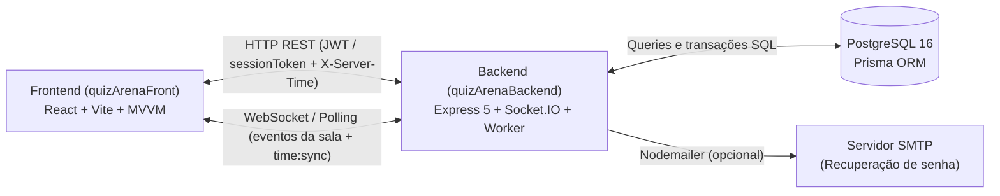

# QuizArena

**Plataforma web de quizzes interativos multiplayer em tempo real, com controle autoritativo no servidor, sincronização de cronômetro e modo dedicado para projeção.**

🚀 **[Acessar QuizArena](https://quizarenagt.vercel.app/)**

[](https://github.com/QuizArenaGt/quizarenagt/actions/workflows/ci-backend.yml)
[](https://github.com/QuizArenaGt/quizarenagt/actions/workflows/ci-frontend.yml)


---

## Sobre o Projeto

O **QuizArena** resolve a condução de dinâmicas competitivas de perguntas e respostas ao vivo — em aulas, treinamentos ou apresentações — com consistência transacional no backend e atualizações instantâneas para todos os participantes conectados.

A experiência gira em torno de três visões integradas:

- **Anfitrião (`/dashboard`):** usuário autenticado que cria salas com código único de 6 caracteres, monta o banco de perguntas, configura tempo e modo de jogo, inicia partidas, conduz as rodadas ao vivo e analisa relatórios.
- **Participante (`/jogar`):** entra apenas com o código da sala, apelido e avatar (sem necessidade de cadastro), responde às rodadas cronometradas e acompanha feedback e ranking parcial/final.
- **Tela de Projeção (`/projetar/:code`):** visualização somente leitura para TVs ou projetores, exibindo código de acesso, enunciado, alternativas, cronômetro sincronizado e placar parcial sem revelar o gabarito antes do fim da rodada.

Todo o fluxo crítico — prazos das rodadas, unicidade de respostas, presença, cálculo de pontuação e encerramento — é validado de forma autoritativa pelo servidor sobre PostgreSQL.

---

## Demonstração

Experimente a aplicação publicada no endereço oficial:

👉 **[Acessar QuizArena (`https://quizarenagt.vercel.app/`)](https://quizarenagt.vercel.app/)**

| Rota principal | Público | Finalidade |
| --- | --- | --- |
| `/` | Visitantes e hosts | Landing page, autenticação (`/login`, `/register`) e recuperação de senha (`/recover-password`, `/reset-password`) |
| `/dashboard` | Anfitrião autenticado | Criação/gestão de salas, banco de perguntas, condução da partida, histórico e relatórios |
| `/jogar` | Jogadores | Lobby, envio de respostas, ocultação automática da pergunta após resposta, feedback e pódio |
| `/projetar/:code` | Anfitrião (TV / Projetor) | Exibição em tela cheia para o público com acompanhamento em tempo real |

<!-- Espaço reservado para inclusão futura de capturas de tela em assets do repositório. -->

---

## Funcionalidades

### Implementadas no Código Atual

- **Salas e Participantes**
  - Geração automática de código único alfanumérico de 6 caracteres, edição de configurações (`maxPlayers`, `questionTime`, modos `CLASSIC` e `HARDCORE`) e arquivamento lógico.
  - Entrada de participantes com token de sessão anônima (`sessionTokenHash`), escolha entre 17 avatares e recuperação automática de estado após recarregar a página (`F5`).
  - Controle de presença em tempo real com janela de reconexão de `60s` e cancelamento automático da partida se restarem menos de `2` jogadores elegíveis.

- **Banco de Questões**
  - Suporte a questões de múltipla escolha (`2` a `4` alternativas) e Verdadeiro/Falso (`TRUE_FALSE`).
  - Importação em lote via JSON (`POST /rooms/:id/questions/import`, limite de `1 MB` e até `100` questões por envio), com inserção em lote transacional e snapshot imutável no início de cada partida.

- **Partidas, Rodadas e Pontuação**
  - Início de partida exigindo mínimo de `2` jogadores ativos e `5` perguntas na sala, com suporte a replay (`play-again`) preservando múltiplas partidas por sala (`1:N`).
  - Sincronização de relógio inspirada em NTP usando `performance.now()` (`X-Server-Time` + evento `time:sync`), além de worker no servidor para fechamento automático por expiração e fechamento manual antecipado pelo host.
  - Pontuação de `100` a `200` pontos por acerto (base + bônus proporcional de velocidade); `0` pontos por erro no modo `CLASSIC` e `-30` pontos no modo `HARDCORE`.
  - Ocultação automática da pergunta no dispositivo do jogador após confirmação do envio da resposta, evitando exposição visual involuntária ao redor.

- **Relatórios, Autenticação e Segurança**
  - Ranking em tempo real, pódio, taxa de acerto, diferenciação entre erros reais e questões não respondidas e estatísticas consolidadas por sala.
  - Autenticação JWT com `tokenVersion` e revogação de sessões em troca/redefinição de senha, normalização de e-mail (`trim().toLowerCase()`), política de senha forte (mínimo de `8` caracteres com letra e número, limite de `72` bytes UTF-8), recuperação via SMTP e rate limiting.

### Em Evolução / Planejadas

- **Persistência de perfil no banco:** o serviço de perfil do frontend (`profileService.ts`) ainda opera de forma simulada no navegador, sem endpoints dedicados no PostgreSQL para atualizar nome, telefone e dados reais de licença.
- **Tema por questão no banco:** o campo `theme` existe na modelagem do frontend, mas no PostgreSQL é persistido atualmente apenas na sala (`rooms`).
- **Pipeline automatizada de CD (Continuous Deployment):** a Etapa 1 de CI está ativa no GitHub Actions; a publicação automatizada condicionada aos checks de CI está planejada para a etapa seguinte.
- **Testes E2E em navegador:** ainda não há suíte automatizada ponta a ponta em browser real (ex.: Playwright ou Cypress).

---

## Tecnologias

| Camada | Tecnologias |
| --- | --- |
| **Frontend** | React `19`, TypeScript, Vite `8`, React Router DOM `7` |
| **Backend** | Node.js `24`, Express `5`, TypeScript, `jsonwebtoken`, `bcryptjs`, Nodemailer |
| **Banco de Dados e ORM** | PostgreSQL `16`, Prisma ORM `6` |
| **Comunicação em Tempo Real** | Socket.IO (handshake dual JWT / `sessionTokenHash` + sincronização `time:sync`) |
| **Infraestrutura e DevOps** | Docker, Docker Compose, GitHub Actions (`ci-backend.yml`, `ci-frontend.yml`) |
| **Testes e Qualidade** | Vitest, Supertest, `@vitest/coverage-v8`, `dotenv-cli`, `node:test` nativo, ESLint, `tsc --noEmit` |

---

## Arquitetura

O QuizArena segue uma arquitetura **cliente–servidor desacoplada**, organizada em monorepo (`quizArenaFront/` no padrão MVVM e `quizArenaBackend/` em camadas): ações mutáveis e consultas iniciais passam pela API REST, enquanto atualizações ao vivo são distribuídas pelo Socket.IO após confirmação transacional no PostgreSQL.



```text
quizarenagt/
├── .github/workflows/   # Pipelines de CI para backend e frontend
├── quizArenaBackend/    # API Express, Socket.IO, Prisma, migrations e testes
├── quizArenaFront/      # Aplicação React + Vite e testes com node:test
├── docker-compose.yml   # Orquestração local (postgres, migrate, backend, frontend, postgres-test)
├── .env.example         # Modelo de variáveis de ambiente na raiz
├── CONTRIBUTING.md      # Diretrizes de contribuição
└── DOCUMENTACAO_TECNICA.md
```

---

## Como Executar Localmente

### Pré-requisitos

- **Git**
- **Docker** e **Docker Compose** (fluxo recomendado)
- **Node.js 24+** e **npm** (necessários para execução fora de containers e para os testes do frontend via `node:test`)

### 1. Clonar o repositório e configurar o ambiente

```bash
git clone https://github.com/QuizArenaGt/quizarenagt.git
cd quizarenagt
cp .env.example .env
```

Edite o arquivo `.env` na raiz preenchendo os valores locais necessários com base em [.env.example](.env.example):

- `DB_USER`, `DB_PASSWORD`, `DB_NAME`, `DATABASE_URL` e `DIRECT_URL`
- `JWT_SECRET` (utilize uma chave com **pelo menos 32 caracteres**)
- `FRONTEND_URL` (padrão local: `http://localhost:5173`)
- `SMTP_*` *(opcional; necessário apenas para testar o envio real de e-mail de recuperação de senha)*

> Nunca versione arquivos `.env` ou `.env.test` com credenciais reais.

### 2. Iniciar com Docker Compose (recomendado)

O [docker-compose.yml](docker-compose.yml) sobe o PostgreSQL `16`, aplica as migrations do Prisma (`migrate`), inicializa o backend e disponibiliza o frontend:

```bash
docker compose up --build -d
```

Acessos locais:

- **Frontend:** `http://localhost:5173`
- **Backend API:** `http://localhost:3000`
- **Health check (com verificação de banco):** `http://localhost:3000/health?check=db`

Para encerrar os containers:

```bash
docker compose down
```

### Alternativa: desenvolvimento local com banco em container

Caso prefira rodar backend e frontend diretamente no Node.js local mantendo apenas o PostgreSQL no Docker:

```bash
# Na raiz: sobe apenas o banco principal
docker compose up -d postgres

# Terminal 1 — Backend
cd quizArenaBackend
npm ci
./node_modules/.bin/prisma generate
./node_modules/.bin/dotenv-cli -e ../.env -- ./node_modules/.bin/prisma migrate deploy
npm run dev

# Terminal 2 — Frontend
cd quizArenaFront
npm ci
npm run dev
```

*(Observação: [quizArenaBackend/src/server.ts](quizArenaBackend/src/server.ts) lê automaticamente o `.env` da raiz do monorepo `../.env`.)*

---

## Testes e CI

### Executar testes localmente

No **Frontend** (`quizArenaFront/` — requer Node.js 24):

```bash
cd quizArenaFront
npm ci
npm run typecheck
npm run lint
npm test
npm run build
```

No **Backend** (`quizArenaBackend/`):

1. Suba o PostgreSQL isolado de testes definido em [docker-compose.yml](docker-compose.yml) (porta `5433`):

   ```bash
   docker compose --profile test up -d postgres-test
   ```

2. Crie o arquivo local `quizArenaBackend/.env.test` (ignorado pelo Git) apontando `DATABASE_URL` e `DIRECT_URL` para o banco de testes na porta `5433`, além de `JWT_SECRET` (mínimo de 32 caracteres) e `FRONTEND_URL`, conforme a estrutura usada em [ci-backend.yml](.github/workflows/ci-backend.yml).

3. Aplique as migrations de teste e execute os scripts de validação:

   ```bash
   cd quizArenaBackend
   npm ci
   ./node_modules/.bin/prisma generate
   npm run typecheck
   npm run build
   npm run db:test:migrate
   npm run test:unit
   npm run test:integration
   ```

Scripts adicionais disponíveis nos manifestos: `npm run test` (todas as suítes do backend), `npm run test:coverage` e `npm run db:test:status` em [quizArenaBackend/package.json](quizArenaBackend/package.json); `npm run preview` em [quizArenaFront/package.json](quizArenaFront/package.json).

### Pipelines no GitHub Actions

Os workflows executam em `push` e `pull_request` direcionados às branches `development` e `main`, sem filtros `paths`:

- **[CI Backend](.github/workflows/ci-backend.yml):** utiliza Node.js 24 e um serviço efêmero `postgres:16-alpine` para gerar o Prisma Client e validar `typecheck`, `build`, `db:test:migrate`, `test:unit` e `test:integration`.
- **[CI Frontend](.github/workflows/ci-frontend.yml):** utiliza Node.js 24 para validar `typecheck`, `lint`, `npm test` e `build`.

---

## Documentação Técnica

Para aprofundamento completo sobre engenharia, arquitetura interna e operação, consulte a [DOCUMENTACAO_TECNICA.md](DOCUMENTACAO_TECNICA.md), que cobre:

- Arquitetura detalhada em camadas no backend e MVVM no frontend;
- Modelagem Prisma, triggers SQL de imutabilidade de snapshots e migrations;
- Contratos REST, eventos Socket.IO e algoritmo de sincronização monotônica;
- Fluxos de autenticação, segurança, recuperação de senha e presença em tempo real;
- Regras completas de pontuação, relatórios, infraestrutura, princípios SOLID, Design Patterns e auditoria de histórico.

---

## Roadmap

Principais evoluções identificadas a partir das limitações documentadas no repositório:

- Implementar a **Etapa 2 (CD)** no GitHub Actions para automatizar o deploy após a aprovação dos checks obrigatórios de CI;
- Substituir a simulação atual de perfil (`profileService.ts`) por endpoints persistidos de usuário no PostgreSQL;
- Adicionar suporte ao campo `theme` diretamente nas questões no banco de dados;
- Adaptar o [Dockerfile do frontend](quizArenaFront/Dockerfile) para servir build estático de produção (ex.: via Nginx) em vez do servidor Vite de desenvolvimento;
- Adicionar suíte de testes End-to-End (E2E) em navegador e suporte a armazenamento distribuído (ex.: Redis) caso a aplicação passe a operar com múltiplas instâncias.

---

## Contribuição

- **Contribuição:** consulte as diretrizes em [CONTRIBUTING.md](CONTRIBUTING.md) para padrões de commits, abertura de Issues e Pull Requests. No fluxo atual do repositório, as integrações e validações de CI concentram-se nas branches `development` e `main`.
